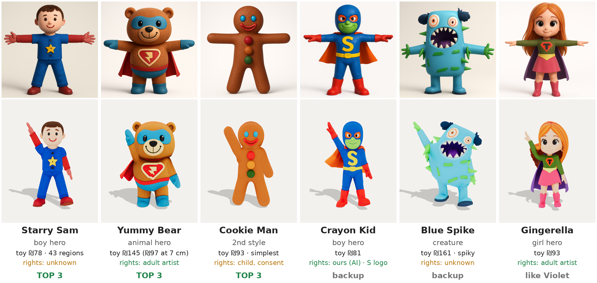

# Poster cast: Nir's shortlist (2026-11-23)

The bar is in `DEMO_CAST.md` (on the PM's branch). There was no provider spend: every
candidate is a hero that already exists in production's Editors' choice.

Top row: the painting. Bottom row: the rig test, with the real `rigged.glb` posed with one
arm up and one leg kicking.

## How I checked each stage

1. **Drawing:** read by eye, internally only. No drawing is in this repo.
2. **Painting:** all 104 Editors' choice paintings (staging and production) on one sheet.
3. **3D and rig:** the finalists' `rigged.glb` was posed (`scripts/toy/bake.js`) and
   rendered. All 7 bend cleanly at the shoulders and hips, with no torn or stretched skin.
   I did not check dance or flip clips; those need the hero on staging.
4. **Toy:** `scripts/toy/toyprep.py` at 8 cm with 5 colours. Each toy came out watertight,
   with no walls under 0.8 mm except the bear's 0.9%. Price is full colour at JLC3DP:
   volume x ₪2.79/cm³.

## Shortlist

| # | Hero (production) | Kind | Drawing | Toy, 8 cm | Rights | Verdict |
|---|---|---|---|---|---|---|
| 1 | **Starry Sam** | boy hero | a real child's: bold, simple, closed outline | 28 cm³, ₪78, 43 colour regions | **unknown**, no artist recorded | top 3 if consent is found |
| 2 | **Yummy Bear** | animal hero | clean, childlike | 52 cm³, ₪145 (₪97 at 7 cm), chunky | adult artist (Elad, 33): ask him | **top 3** |
| 3 | **Cookie Man** | second style | a real child's, very simple | 33 cm³, ₪93, only 19 colour regions: the easiest toy | child (Yuval, 8): needs the parent's consent | top 3 if consent is given |
| 4 | Crayon Kid | boy hero | made with ChatGPT in a crayon style | 29 cm³, ₪81 | **ours** (no consent needed) | backup. The chest "S" looks like Superman's: re-paint without it before any ad |
| 5 | Blue Spike Monster | creature | a real child's, scribbly | 58 cm³, ₪161, 105 regions (spikes) | unknown | backup: the strongest creature, but the dearest toy |
| 6 | Gingerella | girl hero | an adult's (Tom, 20) | 33 cm³, ₪93 | adult artist | too close to Violet (a second girl hero in a cape) |

Rejected:
- **Super Foxy:** the drawing is clearly not a child's (clean professional outlines), so it
  would break "you draw it". It also has a Superman-style logo.
- **Heroes that look like known brands** (a LEGO-like figure, a Minion-like one, Hollow
  Knight, Superman): trademark risk.

## Flags for the PM

- **Violet's rights:** her staging painting is identical to production's "SuperGirl"
  (artist "Michal", 12). DEMO_CAST.md says Violet is house-made. Please confirm where
  Violet's drawing came from before she goes in an ad.
- **A staging demo** of these heroes means copying them from production to staging. That
  needs Raz's yes each time (CLAUDE.md). Crayon Kid is already on staging (as "Super Sami").
- **No new provider spend is needed:** every candidate already has a painting, a model, a
  rig and an avatar.
