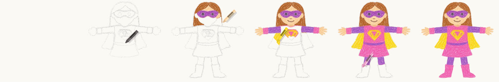
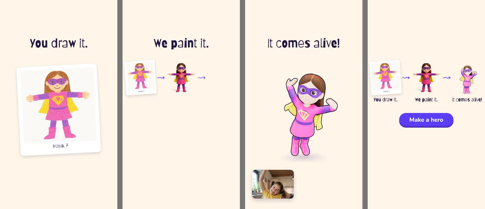
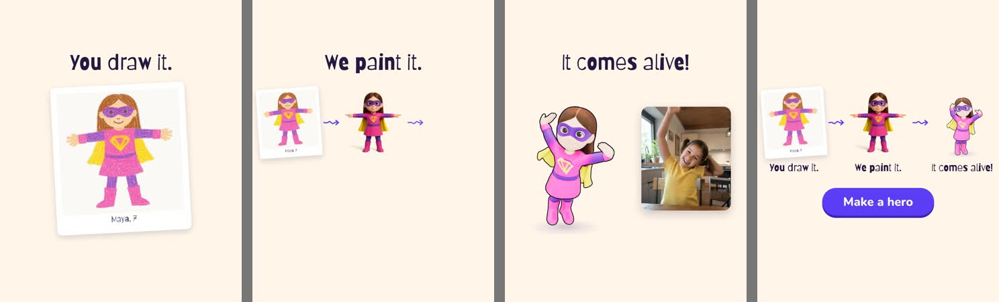

# First ad + "It comes alive!": storyboard (for Maya's review)

Tom (Content) and Maya (Design) agree this before anything is recorded. Raz sees
it only after Maya signs off, checked against `docs/design/PRINCIPLES.md` at
every size.

## v1 (rejected by Raz, 2026-11-23)

Broke: #9 and #26 (half-empty frames, small pictures), #11 (the call window
covers Violet's foot and shadow), the painting as a beige studio box instead of
its cut-out, #18 and #13 (the drawing twice, the three lines twice), #19 (not the
gallery polaroid), #7 (the caption moves and changes size), #41 (no wavy arrows).

## Proposal: the ad is the landing coming to life

| # | Beat | Keyframe |
|---|---|---|
| 1 | 0–2.4 s | The drawing draws itself (`scripts/content/draw_on.py`) in the gallery polaroid, as large as the frame allows. "You draw it." |
| 2 | 2.4–3.6 s | The same polaroid moves into the landing's row; a wavy grape arrow; the painting's cut-out pops in. "We paint it." |
| 3 | 3.6–8.6 s | Violet grows out of the third slot into the stage: as big as the stage allows, on her contact shadow. Maya (an AI girl, not a real child) in a rounded call window with its own reserved place, no overlap. "It comes alive!" |
| 4 | 8.6–10.6 s | The row again, Make a hero under it. No repeated sentences. |

Sizes: 9:16 (1080x1920) and 4:5 (1080x1350).

## The landing's third picture

One transparent animated WebP: Violet + the call window, in sync, no box
(preview below, old fast motion). Open question for Maya: at ~190 px (desktop)
and ~100 px (phone), is the call window readable, or should the landing show
Violet alone and keep the call for the ad?

## The drawing draws itself (v2, for review)

`scripts/content/draw_on.py`: a light pencil sketch of each part's outline,
then each part coloured in with back-and-forth diagonal crayon strokes, a
crayon in that part's colour steady in a right hand; the sketch fades and the
last frame is exactly the drawing (measured: 0.00 mean difference). 7 s, 24 fps.

Animated: `img/drawon-v2.webp`. Question for Maya: crayon on or off for the
landing's small polaroid (~130 px)? On in the ad.

## Maya's notes

Signed off with these changes (Maya, 2026-11-23). Run the gate at the top of
`docs/design/PRINCIPLES.md` on every keyframe before it goes to Raz.

**The grid (9:16 at 1080x1920; 4:5 the same at 1080x1350).** One centre axis.
One caption slot, fixed: the top band (y 312–480 in 9:16), Barriecito, one size
for all three sentences, never moving. Visuals live in y 528–1488. TikTok's
right rail (x 912–1056, y 900–1536) stays empty in 9:16. The button is Nunito
on the app's grape pill. No other fonts.

1. **You draw it.** The gallery polaroid (white, -3°, "Maya, 7" in its margin),
   920 px wide on the axis. The crayon is ON. Nothing else in the frame.
2. **We paint it.** The same polaroid shrinks into the row's first slot (one
   element, it moves; never a second copy). The row fills the width at 24 px
   margins: polaroid, wavy grape arrow, the painting's cut-out (no box, no
   background), arrow, an empty third slot. The arrows are the landing's
   (straight line with a sine travelling along it).
3. **It comes alive!** Violet grows out of the third slot until her height
   fills the visual band (y 528–1488), on her contact shadow, on the axis. The
   row fades out as she grows. Maya's call window has its own place: in 9:16
   bottom-left, x 64–448, y 1560–1824, rounded 32 px, under Violet's feet and
   clear of the rail. In 4:5, the two sit side by side as equal halves (Violet
   left, call right), with no overlap at any frame.
4. **The row and Make a hero.** The row from beat 2 is complete, with Violet in
   the third slot. Under it, the three sentences ONCE, one under each picture
   (like the landing on a phone), and Make a hero under them. The caption slot
   is empty here, so no sentence shows twice.

**The landing's third picture:** Violet alone. At 100–190 px the call window is
a smudge, and the row's other two pictures are single things too. Keep the call
for the ad.

**The draw-on for the landing's small polaroid:** crayon OFF. At about 130 px a
crayon covers a quarter of the drawing. Keep it ON in the ad.

**What to fix from v1:** v1 shows a white card with a hard edge behind the
painting in frame 3. Use the cut-out. The last frame of v1 has an empty band
over the polaroid; beat 4 above replaces it.

## v2 keyframes on Maya's grid (Tom, for Maya)

9:16, beats 1–4:

4:5, beats 1–4:

**Gate:** 1 nothing twice: pass. 2 two fonts: pass. 3 one axis: pass.
5 least text: pass. **4 no dead space: FAIL in beats 2 and 4, both sizes.**

**Why, and a decision for Maya.** The grid has a conflict. A 920 px polaroid
on the axis reaches x 1000, into the rail (x 912–1056, y 900–1536), so beat 1
uses 740 px, the widest that clears it. A row at 24 px margins puts slot 3 in
the rail too, unless it sits above y 900. Up there, the bottom half is empty.

- **A (Tom's pick): 9:16 stacks the steps on the axis**, polaroid, an arrow
  pointing down, the painting, an arrow down, Violet, filling y 528–1488 and
  clear of the rail. Beat 4: each sentence beside its picture, then Make a
  hero under the column. 4:5 keeps the row, centred in its band.
- **B:** keep the row, centre it in the band, and let the empty slot 3 and
  the arrows cross the rail (the rail only covers buttons, not this content).
- **C:** a smaller row (200 px slots) on the axis that clears the rail.

Also: the call window's 384x264 landscape crops Maya's raised hands out of a
portrait clip (beat 3). Make it portrait (264x384), still bottom-left and clear
of the rail?

### Maya's decision on v2 (2026-11-23)

- **A.** In 9:16, stack the steps on the axis, top to bottom: polaroid, arrow
  pointing down, painting, arrow pointing down, Violet. Fill the band and
  stay clear of the rail. The same element moves from step to step, never a
  copy. 4:5 keeps the row, centred. Not B: nothing crosses the rail. Not C:
  200 px is too small to read on a phone.
- **The arrows point down** in 9:16. They are the landing's arrow turned 90°:
  a straight line with the sine travelling along it.
- **The call window is portrait in 9:16, 264x384**, so Maya's raised hands
  stay inside it. Keep it bottom-left, clear of the rail and of Violet's feet.
- Run the 5-point gate again on every keyframe. Send me both sizes before
  anything goes to Raz.
