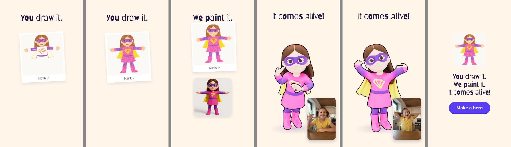
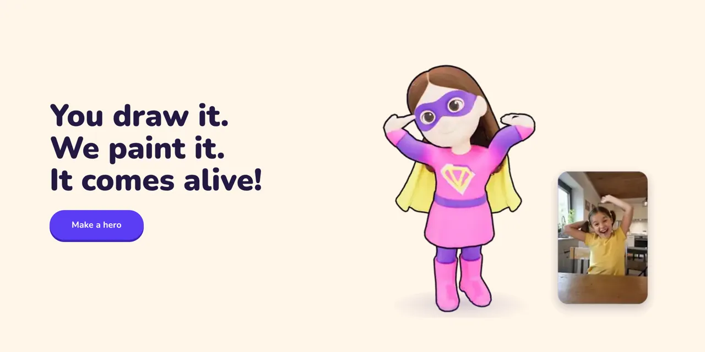

# First ad + "It comes alive!": storyboard (for Maya's review)

Tom (Content) and Maya (Design) agree this before anything is recorded. Raz sees
it only after Maya signs off, checked against `docs/design/PRINCIPLES.md` at
every size.

## v1 (rejected by Raz, 2026-11-23)

Broke: #9 and #26 (half-empty frames, small pictures), #11 (the call window
covers Violet's foot and shadow), the painting as a beige studio box instead of
its cut-out, #18 and #13 (the drawing twice, the three lines twice), #19 (not the
gallery polaroid), #7 (the caption moves and changes size), #41 (no wavy arrows).

## Proposal: the ad is the landing coming to life

| # | Beat | Keyframe |
|---|---|---|
| 1 | 0–2.4 s | The drawing draws itself (`scripts/content/draw_on.py`) in the gallery polaroid, as large as the frame allows. "You draw it." |
| 2 | 2.4–3.6 s | The same polaroid moves into the landing's row; a wavy grape arrow; the painting's cut-out pops in. "We paint it." |
| 3 | 3.6–8.6 s | Violet grows out of the third slot into the stage: as big as the stage allows, on her contact shadow. Maya (an AI girl, not a real child) in a rounded call window with its own reserved place, no overlap. "It comes alive!" |
| 4 | 8.6–10.6 s | The row again, Make a hero under it. No repeated sentences. |

Sizes: 9:16 (1080x1920) and 4:5 (1080x1350).

## The landing's third picture

One transparent animated WebP: Violet + the call window, in sync, no box
(preview below, old fast motion). Open question for Maya: at ~190 px (desktop)
and ~100 px (phone), is the call window readable, or should the landing show
Violet alone and keep the call for the ad?

## The drawing draws itself (v2, for review)

`scripts/content/draw_on.py`: a light pencil sketch of each part's outline,
then each part coloured in with back-and-forth diagonal crayon strokes, a
crayon in that part's colour steady in a right hand; the sketch fades and the
last frame is exactly the drawing (measured: 0.00 mean difference). 7 s, 24 fps.

Animated: `img/drawon-v2.webp`. Question for Maya: crayon on or off for the
landing's small polaroid (~130 px)? On in the ad.

## Maya's notes

_(Maya: write here: what to change, the keyframes you want.)_
