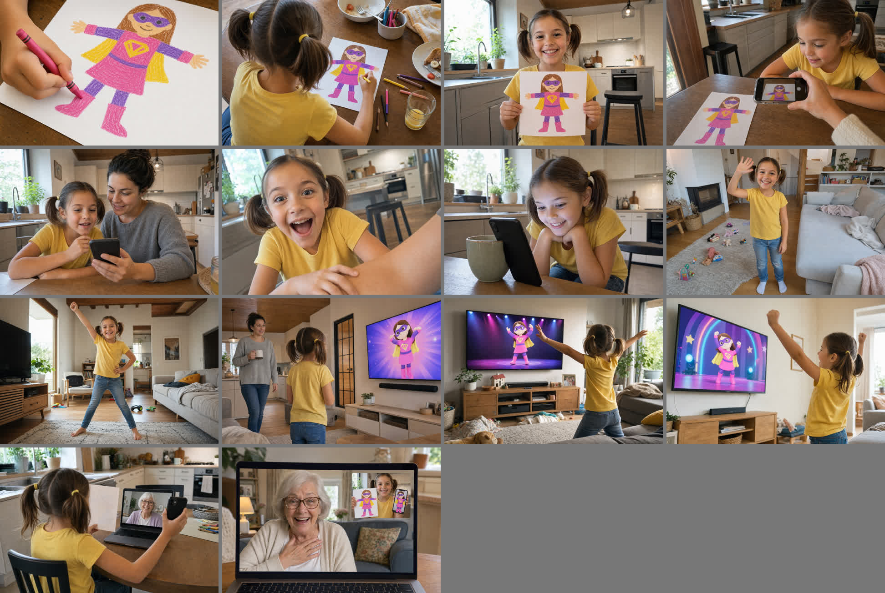
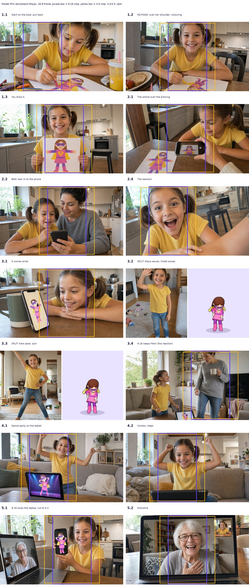

# Master film keyframes (draft, for Maya's storyboard)

One still per live-action shot of `docs/content/scripts/master-film.md`, made
with `scripts/content/keyframes.py` (`gpt-image-2` edits of the same reference
images, so Maya, Mom and the drawing stay the same). Everyone in them is
AI-generated. The screens are placeholders: in the film they are replaced by
recordings of the real app and our real renders.

Order: 1.1 1.2 1.3 2.1 / 2.2 2.4 3.1 3.2 / 3.3 3.4 4.1 4.2 / 5.1 5.2.

Notes for Maya: in 1.2 she smiles at the camera instead of colouring (re-make);
3.2 and 3.3 have her in jeans rather than shorts (one outfit everywhere?).

## Maya's storyboard and look rules (2026-11-23)

Each frame is 16:9. The purple box is the 9:16 crop and the yellow box is the
4:5 crop, each placed on the action.

### Re-make

- **1.2:** over her shoulder, the camera behind her right ear. The drawing
  faces us, the right way up, and she colours the cape. She does not look at
  the camera.
- **One outfit everywhere:** the yellow tee and blue jeans. The kitchen
  shots hide her legs, so only 3.2 and 3.3 show them, and both are already in
  jeans. Keep jeans; never shorts.
- **1.1:** start closer, on the crayon and the pink boot, filling the frame,
  then pull back to this still.
- **3.4:** Mom's face reads as shock. She should stop, then soften into a
  smile; take the still at the smile.

### Look rules for the live-action shots

1. **Eye level is the child's.** The camera is at about 1 m. Mom's shots are
   the only ones from her height (2.1, over the phone).
2. **Daylight, warm, real home.** Keep the kitchen and the sofa as they are;
   no studio light, no shallow-depth "ad" look. It should feel filmed by a
   parent, held steady.
3. **Only the child looks at the camera, and only twice:** 1.3 (holding the
   drawing up) and 2.4 (the reaction). Everywhere else she looks at the
   drawing or the screen.
4. **The action sits in the middle third,** so the 9:16 crop never loses it
   (the purple boxes). Two shots cannot keep everything in 9:16: 3.4 keeps
   Mom, and 5.1 drops the laptop. The 9:16 cut goes from 5.1's phone straight
   to 5.2.
5. **Screens are replaced** by flat, full-brightness recordings of the real
   app, comped into the device. The screen faces the camera within about 20°,
   with no glare and no reflection. A screen must be readable in the 9:16
   crop: at least 25% of the frame's width. 3.1 and 4.1 pass; 2.1 should be
   a little closer.
6. **Product beats (2.3, the end card) are full-frame screen recordings** on
   the Toy Box cream, never a phone photographed on a table.
7. **Text** goes only in the top caption band, Barriecito, one size, as in
   Ad 01. Nothing in the bottom 20% (Instagram and TikTok cover it).

### The split, "Violet copies Maya" (3.2, 3.3)

- **16:9:** two halves side by side. Maya is on the left in her room; Violet
  is on the right on the app's lilac stage, standing on a contact shadow. A
  6 px cream line divides them. Their feet sit on one baseline and their
  heads at one height: scale Violet to Maya, not to the frame.
- **9:16 and 4:5:** stacked, Violet on top (the screen) and Maya underneath
  (the room), each half the frame. Same rule: Violet as tall as Maya.
- **Same moment:** Violet's move starts on the same frame as Maya's (the
  mocap is retargeted from her clip). The split lasts the whole move; never
  cut in the middle of one.
