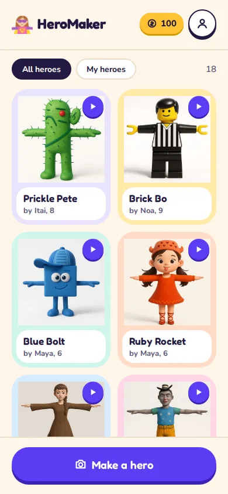
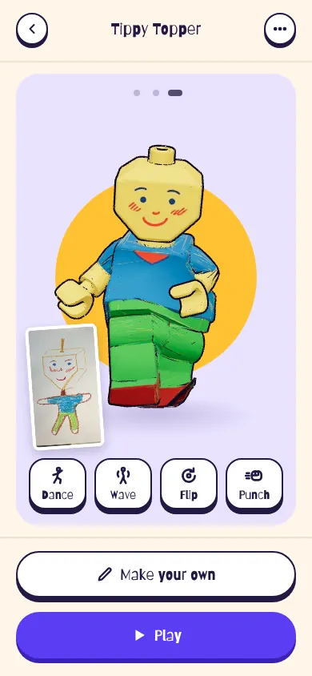
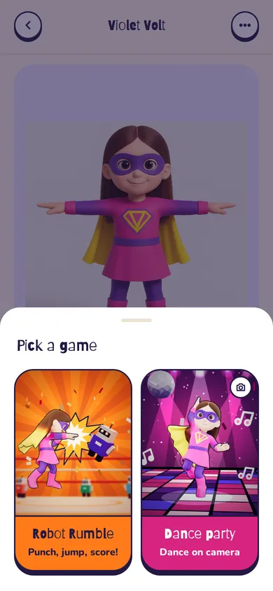
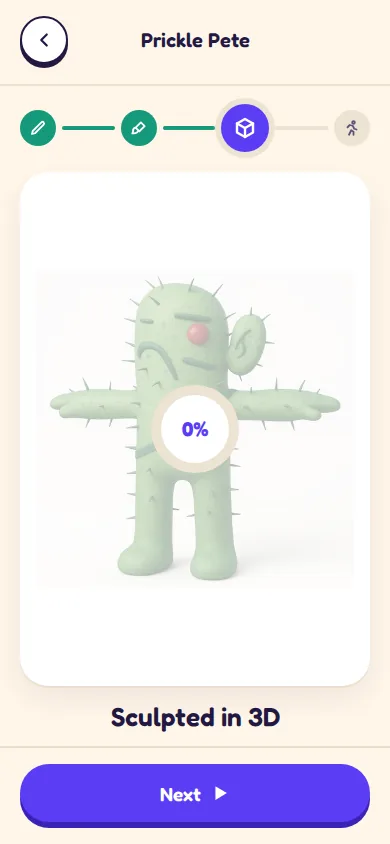
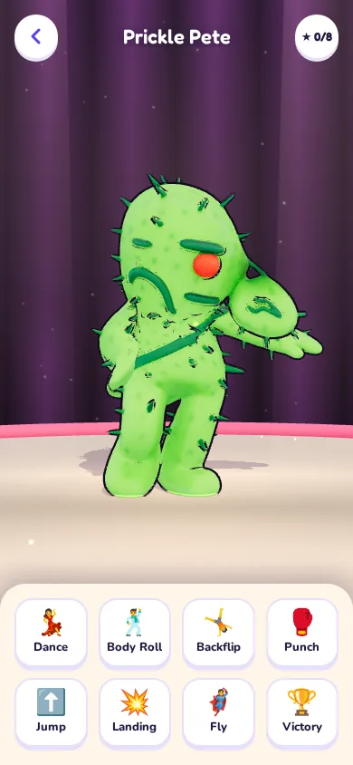
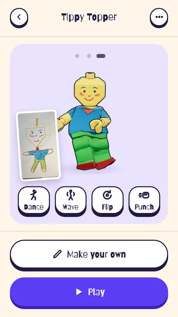
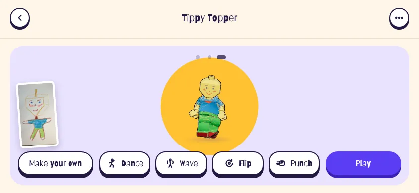
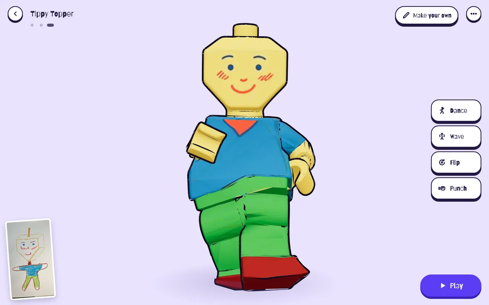

# HeroMaker brand book: Toy Box

**The hero is a toy; the UI is its packaging.** Read this before any UI work. Every rule came from a real rejection or decision by Raz. If a screen breaks a rule, the screen is wrong.

- Visual version (live components, swatches, do/don't pairs): <https://claude.ai/artifact/XESKFupFdphrXKy6JzH2LH>
- Source of truth: `frontend/src/styles/toybox.css`, `frontend/src/components/tb/`, `games/hero-moves/src/ui/reel.css`. Token names below are the CSS variables there.

| Gallery | A ready hero | Pick a game | 3D loading | Stunt show |
|---|---|---|---|---|
|  |  |  |  |  |

## Identity

One theme. No dark mode.

| Token | Value | Use |
|---|---|---|
| `--tb-grape` | `#5B3DF5` | The one primary action per screen; "what is happening now" |
| `--tb-grape-deep` | `#3A22B8` | Grape's depth and shadows only |
| `--tb-grape-text` | `#4B2FE0` | Grape as text (links, eyebrow, ETA) |
| `--tb-sun` | `#FFC233` | Celebration: credits, Best value, combos |
| `--tb-sun-deep` | `#D99A00` | Depth under the credits pill |
| `--tb-ink` | `#231942` | All text; outline + depth of secondary controls |
| `--tb-ink-2` | `#5C5578` | Secondary text |
| `--tb-cream` | `#FFF6E9` | The page, header and bar |
| `--tb-white` | `#FFFFFF` | Cards, sheets, inputs |
| `--tb-line` | `#EADFCB` | input and chip borders, quiet pill depth (never a divider) |
| `--tb-track` | `#EDE3D2` | Not reached yet: stepper, progress background |
| `--tb-green` | `#15997A` | Done |
| `--tb-red` | `#C62828` | Danger, failure |
| `--tb-plate-1..6` | `#E9E3FF` `#FFE9A8` `#CFF5EA` `#FFDCC7` `#D6ECFF` `#FFD6E7` | Plates heroes stand on; gallery tiles cycle 1 to 6 |
| `--tb-rumble` / `--tb-rumble-deep` | `#FF7A1A` / `#D9480F` | Robot Rumble's own colour: its poster and its card footer (ink text, 6.9:1) |
| `--tb-dance` / `--tb-dance-deep` | `#D6247F` / `#1E0B3A` | Dance party's own colour: magenta and its night-club dark (white text, 4.8:1) |
| `--tb-font-display` | Barriecito 400 (Fredoka fallback, and for Hebrew) | The wordmark, names, titles, buttons, numbers (never ones people copy, below). One weight only: `font-synthesis: none`, never fake bold |
| `--tb-font-body` | Nunito 600/700/800 | Text. Never weight 400 |
| `--tb-space` | `16px` | THE visible gap, everywhere |
| `--tb-gutter` | `20px` | Side margins |
| `--tb-stack` | `18px` | Between stacked buttons |
| `--tb-depth` / `--tb-depth-sm` | `6px` / `4px` | Primary / secondary button depth |
| `--tb-btn-h` / `--tb-btn-sm-h` | `58px` / `48px` | Button heights |
| `--tb-header-ctl` | `40px` | Everything in a header: the nav button, the credits pill, the account circle, Sign in, and the logo's girl. 40px from a 390px-wide screen up; below that the whole header row scales with the width (360px: 36.6px) so it stays one line. Each has a 2px outline and `--tb-depth-sm` depth in one colour, so all read 44px tall; the tap area stays 48px |
| `--tb-radius-card` / `--tb-radius-input` | `28px` / `18px` | Cards, tiles, sheets / inputs, notices |

Code on the developer docs (/developers) is the one exception: in code blocks, monospace, white on ink, each with a Copy chip, so columns line up. API keys themselves are still Nunito 800.

Text people must copy exactly (addresses, codes) is never Barriecito: its letters and digits come out unevenly bold and thin. Set it in Nunito 800 (`--tb-font-body`), whose figures are all one width (the class code, the join address, the code keypad).

Contrast: ink on cream 15.2, ink-2 on cream 6.5, grape-text on white 7.5, white on grape 6.1, ink on sun 10.1, red on white 5.6.

Buttons are pills with a hard offset shadow, not a blur: primary `0 6px 0 --tb-grape-deep`, secondary `0 4px 0 --tb-ink` with a 2.5px ink border. Pressed, they sink by the depth (80ms).

## Layout

1. **Same positions on every screen.** Header, a body, bottom bar. One grid. ("COHERENCY AND CONSISTENCY IN ELEMENT POSITIONS")
2. **One header.** `Header` + `NavButton`: a round `--tb-header-ctl` button on each edge, title centred. One nav-button style. Back is always top-start. The gallery's header is the logo at the start (the girl as tall as the pill, "HeroMaker" with the pill's line height, 32px at 390px wide, up to 40px from 430px) and the credits pill and account circle at the end, all one height, on one line at 360px even with a 4-digit balance.
3. **Bottom bar.** Top to bottom: helper line, secondary, primary LAST. The primary is the bottom-most element, in the same place on every screen. The bar always ends with a button. One grape action per screen; secondaries are outlined.
4. **Symmetry.** Paired things (drawing and hero, two game cards) are the same size, side by side. Control bars centred; never a panel in a corner.
5. **No dead whitespace.** The hero or stage flexes to fill what is left.
6. **Scrolling.** "Only scroll if there is significant new information to reveal." Phone screens fit 360 x 640 and up; the hero screen is `100dvh`. Lists (the gallery) are the exception.
7. **Phone-first.** Desktop adapts the same layout (more gallery columns, a bigger stage), in the same cream frame: "Desktop and wide screens" below has every size's numbers. The hero has four moves, Dance, Wave, Flip, Punch, one row on every screen. It never invents screens.
8. **Wider than tall, the hero is the picture in a cream frame.** A phone on its side, a laptop, a desktop: the phone's page, scaled up. A cream header (Back, the name centred, More), ONE plate card, the stage, as big as the frame leaves it, and a cream foot under it: the secondary at the start, the slide's own controls centred (the name card, the four moves, the toy's controls), Play at the end, the last and bottom-most button. Nothing is full bleed, nothing floats over the hero, no arrows, nothing overlaps. Numbers and diagrams: "Desktop and wide screens".

**Hero tiles.** One tile for every hero shown as a card (`components/tb/HeroTile.tsx`): the gallery, the class page's students, the My classes shelf. Same plate, polaroid and size, in one grid: 2 columns on a phone, 3 from 680px of room, 4 from 1060px. The caption is always two lines, a sibling of "Speckle Sally / by Raz, 11": a hero being made says "Sculpting · 45%" on the second line, a child still drawing "Drawing…". No progress bar inside the caption. A tile with no caption (the shelf) centres its art on the plate.

**Switch and chips: two levels, never one row.**
- A screen with more than one *place* (a teacher's home: Gallery, My classes) gets the **switch**, `Segmented` in `components/tb/Segmented.tsx`: directly under the header, above everything else, full width (560px max, centred on a desktop). Equal segments, each 48px tall; a sunken `--tb-track` pill, the chosen segment ink with white text, in the display font, an icon before each label. It does not scroll away.
- **Chips** choose *within* a place (Editors' choice, My heroes, and for admins All heroes and Failed). They sit under the switch, and only in the place they filter: My classes has none.
- A place is never a chip. A fourth chip is cropped at the edge of a phone and missed ("not the fourth option that gets cropped in the filters").
- Something happening now in the other place gets a **strip** under the switch, not a badge: a class in session is a sun strip on Gallery (Live, its name, the time left), the whole strip one tap to it.
- The switch shows only for people with two places ("I run classes" on, in the account sheet). Everyone else sees no switch at all.
- The bottom bar's primary follows the place: Make a hero under Gallery, New class under My classes.
- The place and the chip are remembered apart: back on Gallery finds the chip that was on.

**Account sheet.** Three groups, a space between them (no lines), no headings: you (Buy credits, Redeem a coupon, Edit profile); tools (I run classes, a toggle row; Admin for admins); the session (Sign out, Delete account). It holds settings, never navigation.

**Header card.** The top of a place may carry one card naming what the place belongs to (My classes: the school). A pastel `--tb-plate-*` card, `--tb-radius-card`, `--tb-shadow-card`: a round white badge with the icon at the start, the name in the display font, one body line under it with only the parts that are filled in, a quiet white count pill, and the round pencil (`.tb-nav`) at the end, which opens the editor. The whole card is the same tap. Nothing in it is underlined. With nothing to name yet, the card invites: "Add your school". Text wraps; it never clips at 360px.

**Spacing.** `--tb-space` is the visible gap above and below the header buttons, header to content, between blocks, content to bar, below the last button, in sheets. Padding under a 3D button adds its depth back. The bar adds `env(safe-area-inset-bottom)`.

**No divider lines; space separates.** No horizontal rule anywhere: not under the header, not over the bar, not between groups in a sheet, not beside an "or". The header, the switch and the bar are cream on cream, set apart by `--tb-space` alone; content that scrolls under a sticky one fades into the cream over `--tb-space` (`.tb-header::after`, `.tb-switchbar::after`, `.tb-bar::before`). A pause between groups of sheet rows is `.tb-sheet-divider`, 12px of space. Lines that belong to a thing (a card's outline, a button's depth, an input's border, an admin table's rows) stay.

## Desktop and wide screens

Raz, 2026-11-15: "on mobile, you have this cream-white space behind the yellow, the purple one, and on desktop, you don't have it... the menu on the side, the top bar, and generally the frame around the preview [should be] in the same color." The phone is the reference. Every bigger screen is the same page in the same cream frame, with more room for the picture. Nothing new is invented for a desktop.

### Modes

| Mode | When | Fixed | Fluid |
|---|---|---|---|
| **Phone portrait** (the reference) | taller than wide | the column (100%, at most 560px), 20px gutters, 58px buttons, the 56px dock | the stage's height |
| **Phone on its side** | wider than tall, under 560px tall | 48px buttons in the foot, a 32px dots row, half spaces (8px) round the card | the card's width and height |
| **Tablet / laptop** | wider than tall, 560px tall or more, up to 1180px wide | 58px buttons, the 44px dots row, 16px spaces | the frame (`--tb-frame-x`), the card |
| **Desktop** | 1180 to 1599px wide | the same, moves 140px wide | the card |
| **Wide** | 1600px wide and 800px tall or more | 64px foot buttons, the name card at 1.2x; from 1880 x 900, 72px and 1.35x | the card |

Wider-than-tall is `@media (orientation: landscape)`; the tighter phone-on-its-side rules add `max-height: 559px`. A sheet becomes a centred card from 900 x 600 (below). The fixed things are tokens in `toybox.css`: `--tb-frame-x` (the frame's side margin, `clamp(20px, 2.5vw, 48px)`: 20px on a phone, 36px at 1440, 48px from 1920), `--tb-page-max` (1200px, the gallery's page) and `--tb-dots-h` (44px, the dots' row and each dot's hit area).

### The frame, on every size

- **Cream behind everything.** The header, the side margins and the foot are `--tb-cream`. Only the stage is lavender, and only as a **plate card**: `--tb-plate-1`, `--tb-radius-card` (28px), inside even cream margins (`--tb-frame-x` at the sides, a `--tb-space` under the header, the foot under it).
- **No full bleed.** No lavender to the screen's edges, no control floating over the hero.
- **No arrows** anywhere: a swipe, a mouse drag (the stage shows the grab cursor), the dots and the arrow keys move the stage.
- **Nothing overlaps.** The title, the dots, a caption, each dock control, the bar's buttons and the small drawing each have a place of their own. `e2e/hero-layout.mjs` measures it on every slide (the staging robot runs it at 1280 x 900, 1920 x 1080 and 390 x 844).

### The grid

| Room (the page's width less its margins) | Gallery columns | Tile gap | Page |
|---|---|---|---|
| under 680px | 2 | 12px | the column, 20px gutters |
| 680 to 1059px | 3 | 16px | 1200px (`--tb-page-max`), centred, 20px gutters |
| 1060px and up | 4 (a tile about 278px wide at 1200) | 16px | the same; wider screens get cream margins, never a fifth column |

Text screens (sign in, buy credits, account, forms) stay the 560px column, centred on the cream. Forms inside them are at most 420px. The game itself (`/play`) is its own full-screen world and is not framed.

### The hero page, wider than tall

```
 ┌───────────────────────────────────────────────────────────────────┐  cream
 │ (‹)                       Speckle Sally                       (⋯) │  header, 60px
 │ ╭───────────────────────────────────────────────────────────────╮ │  a space (16px)
 │ │                          ·  ━  ·                              │ │  dots row: a space, 44px, a space
 │ │                                                               │ │
 │ │                         .-~~~-.                               │ │
 │ │                        (  hero  )   the room: as tall as the  │ │
 │ │  ╭────╮                 \_____/     card leaves under the dots│ │
 │ │  │draw│                  |   |      and a space over its foot │ │
 │ │  │ing │                  |   |                                │ │
 │ │  ╰────╯                 _|   |_                               │ │  small drawing: bottom-start,
 │ ╰───────────────────────────────────────────────────────────────╯ │  a space in from the card's edges
 │ [ ✎ Make your own ]   [Dance][Wave][Flip][Punch]       [ ▶ Play ] │  foot: a space, a button, a space
 └───────────────────────────────────────────────────────────────────┘
   ↑ --tb-frame-x                                       --tb-frame-x ↑
```

- **Header:** cream, 60px. Back at the start, the name centred, More (⋯) at the end, each `--tb-frame-x` from the edge. Nothing else lives there.
- **The card:** the stage, centred, as wide as the frame leaves (no cap: the hero is the point) and as tall as the header and the foot leave. It never scrolls.
- **The dots:** centred in their own row at the card's top: a `--tb-space`, the 44px row, a `--tb-space` (Raz: "The indicators of the stage above the character are just too close to the name and the character. It's all too dense. You need to have more breathing space."). Each dot is a 32 x 44px target, so a mouse can click one; a dot goes straight to its slide.
- **The room:** under the dots' row, down to a `--tb-space` above the card's foot. The 3D hero stands as tall as the room; the drawing and the painting are as tall, a space in from its sides.
- **The foot:** cream, under the card: a `--tb-space`, one button (58px; 64px from 1600 wide; 72px from 1880 x 900), its 6px depth, a `--tb-space`. The secondary (Make your own, or Share) at the start, at least 200px wide; **Play at the end, the last and bottom-most button**, the same size. Between them, centred and on the same baseline, the slide's own controls, each one foot button tall:
  - the drawing and the painting: **the name card**, centred under the picture (Raz: "why is the label so far on the left? should be below the character man"), never in a corner. It scales with the screen so it reads as the label of a big picture (Raz: "or bigger"): the phone's size up to 1600px wide, 1.2x from 1600, 1.35x from 1880 (`--cap-s`);
  - the live hero: **the four moves**, labelled pills 140px wide (120px under 1180px; 152px and 164px on wide screens), 12px apart;
  - the toy: **Move, the pieces slider and the .3mf**, bare on the cream like the moves (not a white panel), at most 620px wide;
  - each kept clear of the foot's two buttons by `--foot-side` (220px; 180px under 1180px; 260px and 300px on wide screens; 176px and 158px on a phone on its side).
- **The small drawing:** in the card's bottom-start corner, a `--tb-space` in from its edges, `clamp(110px, min(24cqh, 14cqw), 240px)` across. On the drawing's slide it grows out of that corner into the picture (one element, as on a phone).
- **Captions over a slide** (the locked toy's "A toy you can print") sit in the room, under the dots' row, never on the name or the dots. The made toy has no caption.
- **Phone on its side:** the same frame, tighter: 8px over and under the card, a 32px dots row, 48px foot buttons, moves at their words' width, 6px apart (4px and 13px type under 740px wide, so all four still fit between the two buttons).

The hero **being made** or **failed** stays the phone's page, in a 720px column centred on the cream from 900 x 600 (560px before). Its steps, its ring and its bar are the phone's.

### The full-screen drawing

```
 ┌───────────────────────────────────────────────────────────────────┐  cream
 │ (✕)                        The drawing                            │  header across the frame
 │                          ╭──────────╮                              │
 │                          │          │  the polaroid, tilted, as     │
 │                          │ drawing  │  tall as the screen leaves    │
 │                          │          │                               │
 │                          ╰──────────╯                              │
 │                        [ Speckle Sally ]   name card, a space under │
 │                        [  by Raz, 11   ]                            │
 └───────────────────────────────────────────────────────────────────┘
```

Cream, the header across the frame (Close at `--tb-frame-x`, not in a 560px column), the picture inset by `--tb-frame-x` at the sides, the compact centred name card a `--tb-space` under the tilted frame.

### Sheets and dialogs

| | Phone (and anything under 900 x 600) | 900 x 600 and up |
|---|---|---|
| **Sheet** (More, New hero, the game chooser) | a bottom sheet: full width up to 560px, the grip, rounded top | a **centred card**: 480px wide (the game chooser 640px), `--tb-radius-card` all round, no grip, at most the screen's height less two `--tb-frame-x` |
| **Dialog** (Delete, confirmations) | centred, 420px max, 20px from the edges | the same |

A sheet never runs edge to edge on a desktop, and never sits at the bottom of a 1080px-tall screen.

### Other screens

| Screen | Wider than tall |
|---|---|
| Landing and gallery | the 1200px page on the cream, the header across it, tiles in 3 or 4 columns (the grid above); the bar's button keeps to the middle 560px |
| Sign in, sign up | the 560px column, centred |
| Buy credits | the 560px column |
| Profile / account | the 560px column |
| The game chooser | a centred sheet, 640px, two game cards side by side |
| Class pages | the teacher's page on the 1200px page, class cards 2 across from 720px and 3 from 1100px; the live class screen up to 1600px wide; a child's name and PIN screens in the 420px form |

### Density

- **One `--tb-space` (16px) between any two things that are not one control**: the header and the card, the card's top and the dots' row, the dots' row and the hero, the hero and the card's foot, the card and the foot's buttons.
- Inside one control (a pill's icon and word, a caption's two lines) 2 to 10px.
- Nothing smaller than a `--tb-space` from the card's edge but the card's own rounding.
- If something does not fit, it gets smaller (the moves' width, then their type), never closer, never on top of something else.

## Images

- Never crop: `object-fit: contain`, always.
- Heroes are transparent and stand on a plate (the hero's page: on its contact shadow, no sun behind them).
- An old painting with an opaque studio backdrop is shown from its cut-out (`cut_rendered.png`, `thumb_rendered.png`). One with no confident cut (`painting: "framed"`) is a polaroid, the drawing's tilted white card, never a beige box.
- The hero's stage is one swipe carousel, in a loop: the drawing, the painting, the live hero (the still 3D model is never shown). A ready hero's page opens on how it was made: the drawing, then the painting once it has loaded, then the live hero once the 3D has, about a second on each (Raz, 2026-10-25); any touch ends it there, and from then on it is swipe only. Pager dots over the top of the stage (16px from the top on a phone; on a wide screen their own 44px row, a space clear of the card's top and of the hero), and **no arrows** (Raz: "the left-right arrows, I don't really like them... They're just floating in the middle of nowhere and don't make sense", and "On mobile, we don't need the arrows. I think we can just slide. The indication above the character is enough"). A swipe, a mouse drag, the arrow keys and the dots move it; a dot goes straight to its own slide. The stage's foot is the **dock**, one button tall and 16px inside the stage; each picture fills the room above it, 16px clear of the edges, contained, never cropped, and the dock holds what belongs to the slide in view, at the same height and foot (to the pixel): the drawing and the painting their name card, the gallery tile's caption at the tile's own size (as wide as its words, at least a tile card's 156px, centred, both lines centred; Raz: "too much white space... the same size as it was in the gallery"), the live hero its four moves across the dock's full width, the action figure its controls, so a swipe swaps one for the other in place (Raz: the painting's empty band "looks weird"). **Each is one element, never one per slide** (Raz: "Why 2 label elements if it's same label? Keep it there"): the dock is a stack of layers over the stage (`Dock` in `HeroLive.tsx`), one for the name card, one for the moves, one for the action figure's controls; the slides pass under them and they never move sideways. Each fades by how much of its slides is in the middle, following the finger: between the drawing and the painting the name card simply stays; between the painting and the hero it gives way to the moves in place, one after the other, never one over the other (text over buttons looked messy): the outgoing layer is gone by half way, the incoming one appears only after it, and half way the dock is empty; the same between the moves and the action figure's controls; a snap-back runs it back. A layer more out than in takes no taps. The robot holds slow swipes part-way both ways and fails on a second name card or one that moved. Behind the painting and the live hero the sun stands behind the upper body only, head and torso (Raz, 2026-11-15: "maybe resume the yellow circle we had earlier? it was nice..."), so the figure is still sized to the stage as if nothing were behind it (a cut-out painting by its figure, not by the transparent margin round it). It was off for a while (Raz had asked whether the disc was needed at all); `SUN` in `HeroLive.tsx` is the one flag, and off, the figure stands on a soft contact shadow instead.
- **The drawing is always the gallery's polaroid: white frame, slight tilt, name card under it** (Raz: the hero page's flat card "loses this nice white frame with the slight tilt, and the name is shown differently"). One rule (`.tb-pol` in `HeroTile.css`) and one name card (`TileCaption`: the hero's name, "by Maya, 6") serve the gallery tile, the drawing slide, its small card and its full-screen view, so they never drift apart. The frame hugs the whole picture: no bars inside it, nothing cropped. A tap on the drawing or the painting opens it full screen; Close or Back return to the same slide. Full screen, the name card is the same compact, centred card, one `--tb-space` below the tilted frame's lowest corner (not its untilted box).
- On the painting and the live hero, the drawing stays in view as that small polaroid in the stage's bottom-start corner, just above the dock (on a wide screen, in the corner itself), about a third of the stage across (112px on a phone; on a wide screen `clamp(110px, min(24cqh, 14cqw), 240px)`, in the card's bottom-start corner; Raz: the old 64px card in the top corner was too small). Leaving the drawing, it visibly shrinks into that card; tapping the card (or swiping back) grows it out again (Raz, 2026-10-25: "the drawing goes into the small card smoothly when swiped"). **It is one element, never two**: one polaroid over the stage (`OneDrawing` in `HeroLive.tsx`) placed and scaled between the drawing slide's polaroid and the corner card by how far the drawing's slide is from the middle, so it follows a finger at any speed, either way, and lands with the slide when let go (snapping back too). The two places are invisible stand-ins laid out by the CSS; nothing else ever draws the drawing on the stage. The robot holds slow swipes part-way both ways and fails on anything but one drawing in view. Not over a painting still being made, which already shows the drawing under its ring.
- **The moves are the live hero's own controls** (Raz: "put the buttons inside it, not below it, so that when we preview the painting or the drawing, we don't see them, because we can't make the drawing do a flip or dance. These controls are part of the 3D animation preview."): one centred row of white pills in the dock while the hero is in view (on a wide screen, centred in the foot under the card: "Desktop and wide screens"), fading out as it leaves; never on the drawing or the painting. A tap plays at once. The stage grew into the room the row used to take under it.
- **The owner's hero has a fourth slide, after the live hero: the action figure** (Raz, 2026-11: "show it next in another screen, add it as option with more credits"). The hero cut into parts that print on their own and click together with ball joints (Hi3D, `ActionFigure.tsx`). Only the owner sees it, and only once the hero is ready. Locked, it shows the painting under a white tag, "A toy you can print", and its dock is the buy button, "Make it a toy" with its credits as the trail (too few credits opens Buy credits; a split that fails gives them back and says so). Being made, the painting dims under the ring and the dock is a name card saying so. Made, the parts turn slowly by themselves (a drag on the stage is a swipe, as over the live hero) while the arms and legs swing about their ball joints (Move, on by default: only parts Hi3D cut with a joint move), and the dock is Move, the pieces slider ("Show the pieces") and the `.3mf` for a printer: on a phone in a white card, on a wide screen bare in the foot like the moves, each one foot button tall. No tag over the made toy (a "6 parts · ball joints" pill sat on the name and the dots: "elements override each other its awful"). Users only ever get Hi3D ball joints; the Meshy choice is the admin sheet's. Same dock box as every other slide; on a wide screen, the foot's centre between the secondary and Play.
- Being made, the carousel builds: each part shows its progress where it will appear, and the carousel moves on when it is ready, unless you swiped back to look. Tapping the hero's name in the header renames it (its owner only).
- Thumbnail first, full size swapped in when loaded.
- Each game owns a colour, a world and a pose, so its card reads before its title: never two posters on the same backdrop or in the same stance. Robot Rumble is tangerine rays and a punch; Dance party is a magenta night club and a disco point.

## Text and voice

- Per screen: one title + at most one line of 12 words or fewer. Buttons 1 to 3 words. No paragraphs except legal pages. Longer becomes an icon, a picture, or nothing.
- No redundant titles: a gallery of heroes needs no "Hero Gallery".
- **Kid for play** (making, playing): short, playful, "!" allowed. "Itai's hero is ready", "STUNT! NEW!"
- **Parent for money** (buying, account, errors): calm, plain, precise. "Credits returned", "This can't be undone."
- Our errors never blame the user: "Payments are unavailable right now."
- A failed step reads "Painting failed" and one line chosen by its error code (`backend/app/services/step_errors.py`): "We couldn't paint this picture. Credits returned. Try another drawing or photo." A provider's own words never reach a user; an admin reads them behind a quiet Details chip.
- Words: hero, drawing, gallery, make a hero, play, credits.
- The printable action figure is a **toy** made of **pieces**: "Becoming a toy", "A toy to print", "Show the pieces", "Make the toy". Never cut, cutting, split, dissect or pull apart in anything a person reads (code and admin-only error details may say split). Raz: "I don't think 'cutting it into parts' is the right terminology… It's almost violent."

## Icons

- Only `components/tb/Icon.tsx`: 24 viewBox, stroke 2.4, round caps and joins, `currentColor`. Add new glyphs there, same style.
- No emoji in the UI.
- Icon alone only for back, close, more, play. Everything else gets a label.
- Chips that belong together sit on one line of their own (`.tb-chip-row`): never split across lines, never sharing a line with the text about them, which goes on the line above.

**Staging.** Staging never looks like production. It has its own icon (the hero on ink with a sun STAGING band), its installed name is "HM Staging", and the logo carries a small sun STAGING tag over the foot of its icon. Production has none of these. See CLAUDE.md, "Staging never looks like production".

## Interaction, feedback, motion

- Tap = instant action. No queues, no "build a sequence then press play".
- **No underlined text links.** An action is a button, a row (a tappable card or a `SheetRow`) or a sheet, never a line of underlined text. A card that opens something is the whole card; its ⋯ sits beside it, not inside it.
- Only spending money and deleting confirm first (`Dialog`).
- No wait over 300ms shows nothing: thumbnail or placeholder first, a progress ring with %, the painting dimmed under the ring for 3D, skeleton tiles in the gallery.
- Prefetch what the next step needs. Serve `opt_` GLBs and thumbnails.
- Motion: buttons press, sheets slide up, things pop in with a small bounce. Under 300ms, never blocking a tap. Celebrations get a bigger moment. Respect `prefers-reduced-motion`.

## RTL and Hebrew (planned)

- Logical properties only (`margin-inline-start`, `inset-inline-end`, `text-align: start`). Never left/right in new CSS.
- Mirror directional icons (back, next, redo, logout). Never mirror logos, heroes or media.
- Fredoka has Hebrew (verified on Google Fonts). Nunito does not: Hebrew text uses **Rubik**, which has Hebrew and our 600 to 800 weights (Varela Round has only 400).

## Accessibility

Text 4.5:1. Tap targets 44px. Visible focus (`0 0 0 4px rgba(91,61,245,.25)`). `aria-label` on every icon-only button.

## Do and don't

| Do | Don't |
|---|---|
| One grape primary, last in the bar | Two grape buttons on a screen |
| Helper text above the buttons | Helper text under the button |
| Round 48px back button, top-start, everywhere | A second back control in another style |
| `object-fit: contain` | Cropping a hero or drawing |
| Transparent hero on its plate, the sun behind its upper body | An opaque painting covering the plate, or a disc behind the whole hero that limits its size |
| Paired things equal and side by side | A small drawing in a corner beside a huge hero, as a static thumbnail (the stage's small drawing card is the exception: the drawing itself flies into it, so it reads as the same picture) |
| Moves in one centred bar | A panel stuck in a corner |
| Wider than tall: the stage a plate card in the cream frame, its controls in the cream foot under it | Lavender to the screen's edges, or controls floating over the hero |
| Every element in a place of its own (`e2e/hero-layout.mjs` checks) | A caption on the name or the dots; two things in one spot |
| A swipe, a drag, the dots (44px targets), the arrow keys | Previous and Next arrows |
| The name card centred under the picture, scaled with the screen | The name card in a corner, or a phone-sized chip under a 1000px picture |
| A space between the name, the dots and the hero | The dots touching the hero's head or the header |
| On a desktop, a sheet as a centred card | A bottom drawer across a 1920px screen |
| The hero's moves inside its own slide | Moves under every slide, on a drawing that cannot dance |
| The drawing as the gallery's tilted polaroid with its name card | A flat drawing card with its own name strip |
| A labelled pill: "How it was made" | An unlabelled icon for anything but back/close/more/play |
| The painting dimmed under a % ring | An empty card while 3D loads |
| Tap a move, it plays | Queue moves, then press play |
| One title, one short line | A title, a subtitle and a paragraph |
| Line icons | Emoji |
| `margin-inline-start` | `margin-left` |
| A button, row, chip or toggle for every action (OK in a notice is a small secondary button) | An underlined text link |
| A place on the switch under the header | A place as the fourth chip, cropped off the edge |
| The school on a plate card with a pencil | An underlined link for a name people care about |
| Space between header, content and bar; a soft fade where content scrolls under | A horizontal line splitting the screen, a sheet or an "or" |

## Rejected, and why

- **Six directions → Toy Box.** Today tidied, Toy Box, Ka-Pow, Player One, The Exhibition, Kitchen Table. Toy Box won: the renders look like vinyl toys.
- **Cropped images.** "Not good that you crop the content!" Now `contain`.
- **Asymmetric drawing and hero.** Paired things are equal now.
- **Helper text under the button.** It moved the primary. Now above.
- **Corner-panel game.** "this layout is horrible". Now one centred bar.
- **A full-width name card in the full-screen drawing.** "not centred, too wide, and not enough space between it and the drawing". Now the slides' compact centred card, a space below the tilted frame.
- **Unlabelled layers icon** for How it was made: "not clear enough". Now a labelled pill.
- **Steps strip, polaroid swap, auto-play and 8 moves** on the hero's stage: "You don't see a lot of interesting important things like the drawing or the 3D character". The hero covered 25% of the phone. Now a swipe carousel, no automatic play, four moves.
- **Artist name and pager dots stacked under the drawing**: "too small, too close to the edge", then "too dense ... not coherent with the rest of the app". The dots went to the top; the name is the drawing card's own strip.
- **Empty 3D loading card.** "Empty screen for 10 seconds WTF?!" Now a ring over the dimmed painting.
- **Queue-then-play game.** "as soon as an animation is clicked just play it".
- **Full-screen drawing viewer** (dark scrim, Drawing | Hero toggle): "It doesn't look like part of the app ... this preview of 2 steps. It's confusing." Now the polaroid swaps into the stage and the 4-step strip is the one way through.
- **Chips broken across lines.** "Refunds and terms should be in new line not break line like currently. This is a recurring comment." A line of text and the chips about it never share a line: the text on its own line, the chips together on the next (`.tb-chip-row`, never wraps). The footer's version gets its own line too.
- **Underlined text links.** "No underlined links." Every action is a button, a row, a chip or a toggle; `.tb-link` is gone.
- **The name and the dots at the top-start on a wide screen.** Beside Back, away from the hero: "the indication of step inside the carousel needs to be centered above the character not in the left. same as character name". Both are centred over the hero now.
- **No sign the stage swipes.** Dots alone: "there is no indication that you're supposed to swipe... add arrows or something". Previous and Next arrows came, then went: see the next entry.
- **Floating Previous and Next arrows** (to v2.0.105): "the left-right arrows, I don't really like them. I don't think they look good, especially on desktop. They're just floating in the middle of nowhere and don't make sense", and "On mobile, we don't need the arrows. I think we can just slide. The indication above the character is enough". Now none: swipe, drag, the dots and the arrow keys.
- **A full-bleed lavender stage on a desktop** (to v2.0.105): the stage was the whole viewport with the controls floating over it, so the desktop lost the phone's cream frame: "on mobile, you have this cream-white space behind the yellow, the purple one, and on desktop, you don't have it." Now a plate card in a cream frame, its controls in the cream foot.
- **Dots crammed between the name and the hero**: "The indicators of the stage above the character are just too close to the name and the character. It's all too dense. You need to have more breathing space." Now their own 44px row, a space clear on each side.
- **Elements on top of each other** (v2.0.105, the toy's slide at 2000px): a "6 parts · ball joints" pill on the name and the dots, the toy's controls in a white panel floating at the bottom: "layout is horrible man elements override each other its awful". Now the made toy has no tag, its controls sit in the foot like the moves, and `e2e/hero-layout.mjs` fails on any overlap.
- **The name card in the corner** (v2.0.105, wide screens): the drawing centred, its card at the bottom-start: "why is the label so far on the left? should be below the character man", then "or bigger, i dont know". Now centred under the picture and scaled with the screen.
- **Names under the step dots.** Tried; Raz: "Remove the labels, but make the transition automatic between the phases." The steps now play by themselves.
- **My classes as a chip.** The fourth chip on a phone, cut off at the edge: "I could miss it. It needs a higher level in the hierarchy." Now the switch.
- **Two columns on a wide screen.** A phone on its side and the desktop put the stage in one half and the four moves and two buttons in the other, mostly empty: "This is an awful desktop layout. You need to have most of the area showing the character and then have these controls under it or over, like overlay, but don't use half the screen just for a few buttons where most of the space is empty." Now the stage takes the width and its controls sit in one row at its foot.
- **A capped stage with a row of six buttons across its foot.** The next try (v2.0.89) kept the stage under 1100px and ran the moves and both bar buttons in one row along its bottom; at 844 x 390 the hero was a small figure in a 215px sun: "This is still a horrible desktop layout. Look at how much of the screen is empty. Look at the size of the hero compared to the size of the screen. You need to completely redo the desktop layout." Now the stage is the viewport, the hero 75% of its height or more, and the controls are small at its edges.
- **The sun behind the whole hero.** It framed the whole figure, so the figure was drawn to fit inside it; Raz asked whether the disc was needed at all, and it went. He then missed it ("maybe resume the yellow circle we had earlier? it was nice..."): it is back, behind the upper body only, the figure as big as without it (`SUN` in `HeroLive.tsx`).
- **An empty band under the painting.** The drawing had its name card and the hero its moves; the painting had nothing there: it "looks weird". Now the painting carries the same name card, in the same box the moves take on the hero.
- **Moves under every slide.** Kept under the drawing and the painting so the page would not jump: "we can't make the drawing do a flip or dance. These controls are part of the 3D animation preview." Now they live in the hero's slide.
- **Two drawings during a slow swipe back** (2026-11): the drawing slide's polaroid slid in while the small card was still showing, and a copy flew between them only once the slide had changed. "It needs to be exactly like the same element. The drawing that shrinks to the image is going back to be the image in the drawing preview. Don't duplicate." Now one polaroid, driven by the swipe itself.
- **A full-width name bar** under the drawing and the painting (2026-11): "It looks awful. It has too much white space. It needs to be more condensed. Maybe just like centered and the same size as it was in the gallery." A Hebrew name sat at one end and its "by" line at the other. Now the gallery tile's caption, its own size, centred.
- **A name card on every slide** (2026-11): the drawing and the painting each carried their own copy, so a swipe slid two identical cards past each other. "Why 2 label elements if it's same label? Keep it there." Now one name card in the stage's dock that stays put while the slides move under it, giving way to the moves and the action figure's controls in the same place, one after the other.
- **A flat drawing card with a name strip** on the hero's page: it "loses this nice white frame with the slight tilt, and the name is shown differently". Now the gallery's polaroid and name card, the same rule as the tile.
- **Divider lines.** A 2px hairline under the header, over the bar, between groups in the ⋯ menu and beside "or": "Continuing the effort to simplify and beautify the layout, I don't think we need the horizontal line splits, so remove them and fix the spacing afterwards in all screens everywhere." Now space separates, and a soft fade marks where content scrolls under.
- **The school as a text link.** Grape, underlined: "looks like a link in a document. Doesn't give me a good feeling about my school." Now a header card.

Mock-ups of each are in the artifact's "Rejected" card.

## Before you show Raz any UI

1. Screenshot every screen you touched at **360x640, 390x844, 844x390, 1280x800, 1440x900, 1920x1080** and check each against this book (the Do/Don't table is the quick pass). For the hero page, also run `node e2e/hero-layout.mjs <url> <hero-id>`.
2. Robot-test staging with Playwright, the whole flow: landing → gallery → sign in → buy credits (Lemon Squeezy test mode) → upload a drawing → image → 3D → rigged and animated → the hero in the profile → play a game.
3. Send a short message: the one ask at the top, on its own line, with a working staging link. Then what you tested.
4. Never ask for approval without a link.

| 360 x 640 | 390 x 844 | 844 x 390 | 1280 x 800 |
|---|---|---|---|
|  |  |  |  |

## Known debt (do not copy)

- Primary above secondary in the New hero sheet and Delete dialog. Rule: primary last.
- Hero screen being made or failed on a desktop: the phone's page in a 720px column, not yet the frame and foot a ready hero has. (On a phone on its side the stage is on one side full height, the steps and the status on the other above the bar, whose buttons share one row there, primary at the end.)
- The screenshots in the table above are from before the desktop frame; retake them at the next release.
- Signed-out gallery has a 25-word paragraph under the headline.
- The Stunt show prototype (`reel.html`, GitHub Pages only: its moves now live on the hero's page) uses emoji cards and a "★" combo counter.
- `--tb-line` borders on inputs and chips are 1.3:1, under the 3:1 a control border needs.
- toybox.css's header comment says "Header 64px" and "32px from the bottom"; real: 80px + 4px depth, 16px visible.
- Physical left/right in CSS: `.tb-btn-trail`, `.tb-header-title`, `.tb-sheet-row`, `.tb-stage-img`, `.tb-polaroid`, `.tb-notice button`, `.tb-pill`, `.buy-credits-pack`. No Hebrew text font loaded yet.

More screenshots: [`img/`](img/) (gallery signed in/out and loading, sign up, buy credits, account, new hero, How it was made, the game in portrait and landscape).
