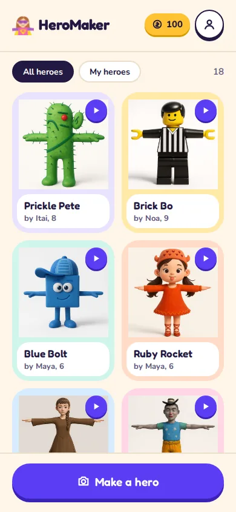
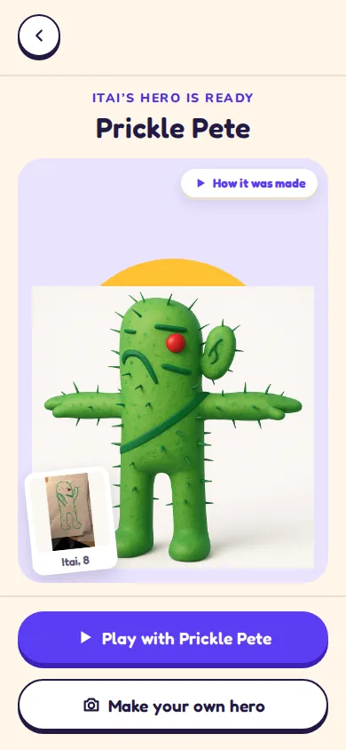
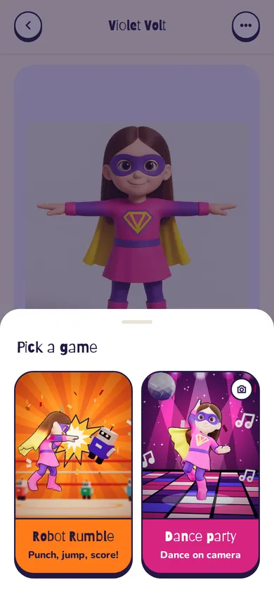
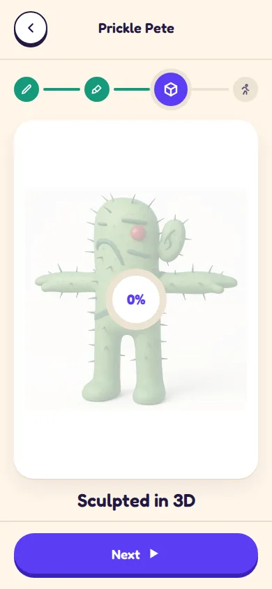
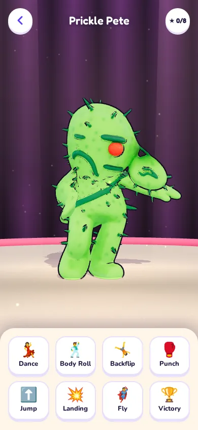
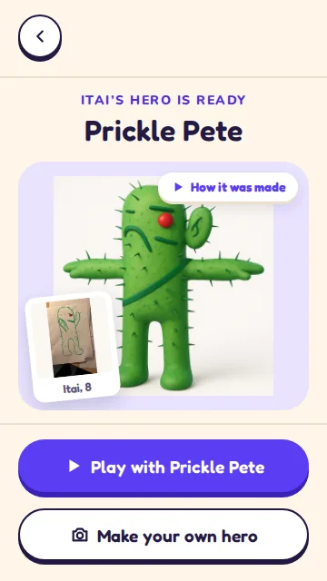
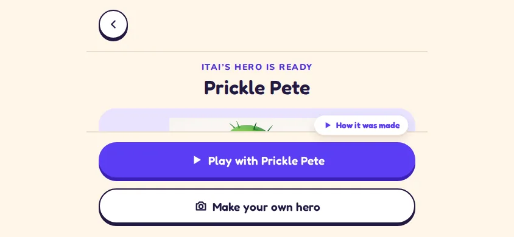
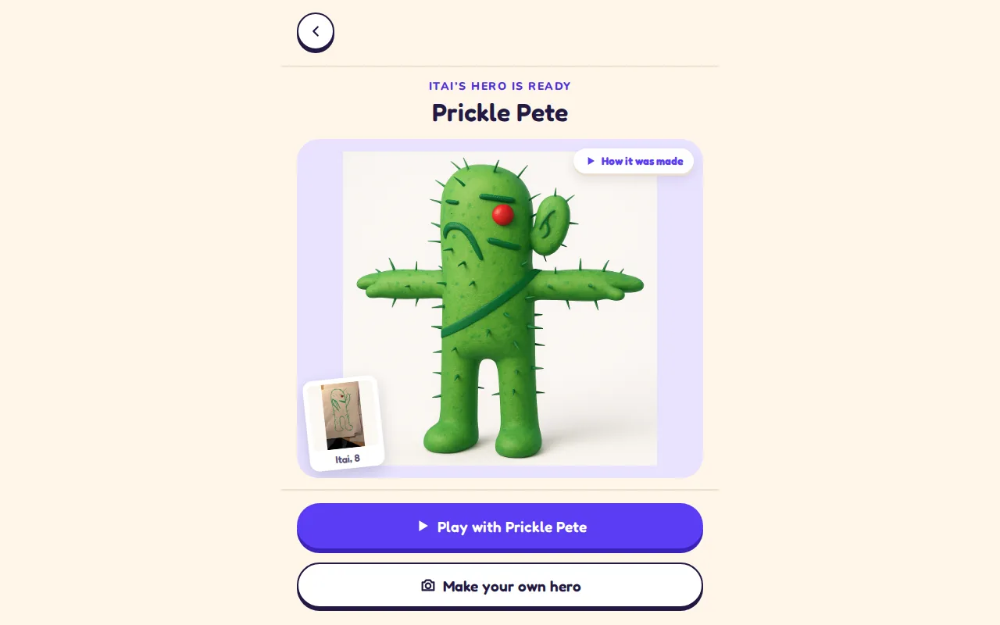

# HeroMaker brand book: Toy Box

**The hero is a toy; the UI is its packaging.** Read this before any UI work. Every rule came from a real rejection or decision by Raz. If a screen breaks a rule, the screen is wrong.

- Visual version (live components, swatches, do/don't pairs): <https://claude.ai/artifact/XESKFupFdphrXKy6JzH2LH>
- Source of truth: `frontend/src/styles/toybox.css`, `frontend/src/components/tb/`, `games/hero-moves/src/ui/reel.css`. Token names below are the CSS variables there.

| Gallery | A ready hero | Pick a game | 3D loading | Stunt show |
|---|---|---|---|---|
|  |  |  |  |  |

## Identity

One theme. No dark mode.

| Token | Value | Use |
|---|---|---|
| `--tb-grape` | `#5B3DF5` | The one primary action per screen; "what is happening now" |
| `--tb-grape-deep` | `#3A22B8` | Grape's depth and shadows only |
| `--tb-grape-text` | `#4B2FE0` | Grape as text (links, eyebrow, ETA) |
| `--tb-sun` | `#FFC233` | Celebration: the sun behind a ready hero, credits, Best value, combos |
| `--tb-sun-deep` | `#D99A00` | Depth under the credits pill |
| `--tb-ink` | `#231942` | All text; outline + depth of secondary controls |
| `--tb-ink-2` | `#5C5578` | Secondary text |
| `--tb-cream` | `#FFF6E9` | The page, header and bar |
| `--tb-white` | `#FFFFFF` | Cards, sheets, inputs |
| `--tb-line` | `#EADFCB` | 2px hairlines, input and chip borders |
| `--tb-track` | `#EDE3D2` | Not reached yet: stepper, progress background |
| `--tb-green` | `#15997A` | Done |
| `--tb-red` | `#C62828` | Danger, failure |
| `--tb-plate-1..6` | `#E9E3FF` `#FFE9A8` `#CFF5EA` `#FFDCC7` `#D6ECFF` `#FFD6E7` | Plates heroes stand on; gallery tiles cycle 1 to 6 |
| `--tb-rumble` / `--tb-rumble-deep` | `#FF7A1A` / `#D9480F` | Robot Rumble's own colour: its poster and its card footer (ink text, 6.9:1) |
| `--tb-dance` / `--tb-dance-deep` | `#D6247F` / `#1E0B3A` | Dance party's own colour: magenta and its night-club dark (white text, 4.8:1) |
| `--tb-font-display` | Barriecito 400 (Fredoka fallback, and for Hebrew) | The wordmark, names, titles, buttons, numbers (never ones people copy, below). One weight only: `font-synthesis: none`, never fake bold |
| `--tb-font-body` | Nunito 600/700/800 | Text. Never weight 400 |
| `--tb-space` | `16px` | THE visible gap, everywhere |
| `--tb-gutter` | `20px` | Side margins |
| `--tb-stack` | `18px` | Between stacked buttons |
| `--tb-depth` / `--tb-depth-sm` | `6px` / `4px` | Primary / secondary button depth |
| `--tb-btn-h` / `--tb-btn-sm-h` | `58px` / `48px` | Button heights; 48 is also the nav button and the credits pill — everything in a header is 48 tall with `--tb-depth-sm` depth |
| `--tb-radius-card` / `--tb-radius-input` | `28px` / `18px` | Cards, tiles, sheets / inputs, notices |

Text people must copy exactly (addresses, codes) is never Barriecito: its letters and digits come out unevenly bold and thin. Set it in Nunito 800 (`--tb-font-body`), whose figures are all one width (the class code, the join address, the code keypad).

Contrast: ink on cream 15.2, ink-2 on cream 6.5, grape-text on white 7.5, white on grape 6.1, ink on sun 10.1, red on white 5.6.

Buttons are pills with a hard offset shadow, not a blur: primary `0 6px 0 --tb-grape-deep`, secondary `0 4px 0 --tb-ink` with a 2.5px ink border. Pressed, they sink by the depth (80ms).

## Layout

1. **Same positions on every screen.** Header, a body, bottom bar. One grid. ("COHERENCY AND CONSISTENCY IN ELEMENT POSITIONS")
2. **One header.** `Header` + `NavButton`: a round 48px button on each edge, title centred. One nav-button style. Back is always top-start.
3. **Bottom bar.** Top to bottom: helper line, secondary, primary LAST. The primary is the bottom-most element, in the same place on every screen. The bar always ends with a button. One grape action per screen; secondaries are outlined.
4. **Symmetry.** Paired things (drawing and hero, two game cards) are the same size, side by side. Control bars centred; never a panel in a corner.
5. **No dead whitespace.** The hero or stage flexes to fill what is left.
6. **Scrolling.** "Only scroll if there is significant new information to reveal." Phone screens fit 360 x 640 and up; the hero screen is `100dvh`. Lists (the gallery) are the exception.
7. **Phone-first.** Desktop adapts the same layout (more gallery columns, bigger stage, one row of 8 moves). It never invents screens.

**Hero tiles.** One tile for every hero shown as a card (`components/tb/HeroTile.tsx`): the gallery, the class page's students, the My classes shelf. Same plate, polaroid and size, in one grid: 2 columns on a phone, 3 from 680px of room, 4 from 1060px. The caption is always two lines, a sibling of "Speckle Sally / by Raz, 11": a hero being made says "Sculpting · 45%" on the second line, a child still drawing "Drawing…". No progress bar inside the caption. A tile with no caption (the shelf) centres its art on the plate.

**Switch and chips: two levels, never one row.**
- A screen with more than one *place* (a teacher's home: Gallery, My classes) gets the **switch**, `Segmented` in `components/tb/Segmented.tsx`: directly under the header, above everything else, full width (560px max, centred on a desktop). Equal segments, each 48px tall; a sunken `--tb-track` pill, the chosen segment ink with white text, in the display font, an icon before each label. It does not scroll away.
- **Chips** choose *within* a place (Editors' choice, My heroes, and for admins All heroes and Failed). They sit under the switch, and only in the place they filter: My classes has none.
- A place is never a chip. A fourth chip is cropped at the edge of a phone and missed ("not the fourth option that gets cropped in the filters").
- Something happening now in the other place gets a **strip** under the switch, not a badge: a class in session is a sun strip on Gallery (Live, its name, the time left), the whole strip one tap to it.
- The switch shows only for people with two places ("I run classes" on, in the account sheet). Everyone else sees no switch at all.
- The bottom bar's primary follows the place: Make a hero under Gallery, New class under My classes.
- The place and the chip are remembered apart: back on Gallery finds the chip that was on.

**Account sheet.** Three groups, two dividers, no headings: you (Buy credits, Redeem a coupon, Edit profile); tools (I run classes, a toggle row; Admin for admins); the session (Sign out, Delete account). It holds settings, never navigation.

**Header card.** The top of a place may carry one card naming what the place belongs to (My classes: the school). A pastel `--tb-plate-*` card, `--tb-radius-card`, `--tb-shadow-card`: a round white badge with the icon at the start, the name in the display font, one body line under it with only the parts that are filled in, a quiet white count pill, and the round pencil (`.tb-nav`) at the end, which opens the editor. The whole card is the same tap. Nothing in it is underlined. With nothing to name yet, the card invites: "Add your school". Text wraps; it never clips at 360px.

**Spacing.** `--tb-space` is the visible gap above and below the header buttons, header to content, between blocks, content to bar, below the last button, in sheets. Padding under a 3D button adds its depth back. 2px `--tb-line` hairline between header/bar and scrolling content. The bar adds `env(safe-area-inset-bottom)`.

## Images

- Never crop: `object-fit: contain`, always.
- Heroes are transparent and stand on a plate or a sun.
- An old painting with an opaque studio backdrop is shown from its cut-out (`cut_rendered.png`, `thumb_rendered.png`). One with no confident cut (`painting: "framed"`) is a polaroid, the drawing's tilted white card, never a beige box.
- The drawing is a polaroid (white frame, -6deg, artist's name and age). Its photo takes the drawing's shape: no empty white beside a tall drawing. On the ready hero's stage, one tap (enlarge mark in its corner) swaps it in: the drawing big on the same stage, the hero small in the corner, and the steps strip on top. The steps then play by themselves at the intro's pace (about 1s each once on screen: drawing, painting, sculpt, then back to the hero), and the strip is a timeline: one purple circle slides from step to step, leaving a purple trail behind it (green ahead), and the line ahead of it fills purple while the step plays. A tap on a step jumps there and it carries on from it. The strip's dots carry no names (Raz's call), and the current dot and its ring sit inside the pill, never against its edge. A tap on the big drawing (its enlarge mark) opens it full screen as a page of the app: cream, the header's round close button, "The drawing", the polaroid as big as it fits, pinch to zoom. Close or Back return to the steps.
- Thumbnail first, full size swapped in when loaded.
- Each game owns a colour, a world and a pose, so its card reads before its title: never two posters on the same backdrop or in the same stance. Robot Rumble is tangerine rays and a punch; Dance party is a magenta night club and a disco point.

## Text and voice

- Per screen: one title + at most one line of 12 words or fewer. Buttons 1 to 3 words. No paragraphs except legal pages. Longer becomes an icon, a picture, or nothing.
- No redundant titles: a gallery of heroes needs no "Hero Gallery".
- **Kid for play** (making, playing): short, playful, "!" allowed. "Itai's hero is ready", "STUNT! NEW!"
- **Parent for money** (buying, account, errors): calm, plain, precise. "Credits returned", "This can't be undone."
- Our errors never blame the user: "Payments are unavailable right now."
- A failed step reads "Painting failed" and one line chosen by its error code (`backend/app/services/step_errors.py`): "We couldn't paint this picture. Credits returned. Try another drawing or photo." A provider's own words never reach a user; an admin reads them behind a quiet Details chip.
- Words: hero, drawing, gallery, make a hero, play, credits.

## Icons

- Only `components/tb/Icon.tsx`: 24 viewBox, stroke 2.4, round caps and joins, `currentColor`. Add new glyphs there, same style.
- No emoji in the UI.
- Icon alone only for back, close, more, play. Everything else gets a label.

**Staging.** Staging never looks like production. It has its own icon (the hero on ink with a sun STAGING band), its installed name is "HM Staging", and the logo carries a small sun STAGING tag over the foot of its icon. Production has none of these. See CLAUDE.md, "Staging never looks like production".

## Interaction, feedback, motion

- Tap = instant action. No queues, no "build a sequence then press play".
- **No underlined text links.** An action is a button, a row (a tappable card or a `SheetRow`) or a sheet, never a line of underlined text. A card that opens something is the whole card; its ⋯ sits beside it, not inside it.
- Only spending money and deleting confirm first (`Dialog`).
- No wait over 300ms shows nothing: thumbnail or placeholder first, a progress ring with %, the painting dimmed under the ring for 3D, skeleton tiles in the gallery.
- Prefetch what the next step needs. Serve `opt_` GLBs and thumbnails.
- Motion: buttons press, sheets slide up, things pop in with a small bounce. Under 300ms, never blocking a tap. Celebrations get a bigger moment. Respect `prefers-reduced-motion`.

## RTL and Hebrew (planned)

- Logical properties only (`margin-inline-start`, `inset-inline-end`, `text-align: start`). Never left/right in new CSS.
- Mirror directional icons (back, next, redo, logout). Never mirror logos, heroes or media.
- Fredoka has Hebrew (verified on Google Fonts). Nunito does not: Hebrew text uses **Rubik**, which has Hebrew and our 600 to 800 weights (Varela Round has only 400).

## Accessibility

Text 4.5:1. Tap targets 44px. Visible focus (`0 0 0 4px rgba(91,61,245,.25)`). `aria-label` on every icon-only button.

## Do and don't

| Do | Don't |
|---|---|
| One grape primary, last in the bar | Two grape buttons on a screen |
| Helper text above the buttons | Helper text under the button |
| Round 48px back button, top-start, everywhere | A second back control in another style |
| `object-fit: contain` | Cropping a hero or drawing |
| Transparent hero on a plate or sun | An opaque painting covering the sun |
| Paired things equal and side by side | A small drawing in a corner beside a huge hero |
| Moves in one centred bar | A panel stuck in a corner |
| A labelled pill: "How it was made" | An unlabelled icon for anything but back/close/more/play |
| The painting dimmed under a % ring | An empty card while 3D loads |
| Tap a move, it plays | Queue moves, then press play |
| One title, one short line | A title, a subtitle and a paragraph |
| Line icons | Emoji |
| `margin-inline-start` | `margin-left` |
| A button, row, chip or toggle for every action (OK in a notice is a small secondary button) | An underlined text link |
| A place on the switch under the header | A place as the fourth chip, cropped off the edge |
| The school on a plate card with a pencil | An underlined link for a name people care about |

## Rejected, and why

- **Six directions → Toy Box.** Today tidied, Toy Box, Ka-Pow, Player One, The Exhibition, Kitchen Table. Toy Box won: the renders look like vinyl toys.
- **Cropped images.** "Not good that you crop the content!" Now `contain`.
- **Asymmetric drawing and hero.** Paired things are equal now.
- **Helper text under the button.** It moved the primary. Now above.
- **Corner-panel game.** "this layout is horrible". Now one centred bar.
- **Unlabelled layers icon** for How it was made: "not clear enough". Now a labelled pill.
- **Empty 3D loading card.** "Empty screen for 10 seconds WTF?!" Now a ring over the dimmed painting.
- **Queue-then-play game.** "as soon as an animation is clicked just play it".
- **Full-screen drawing viewer** (dark scrim, Drawing | Hero toggle): "It doesn't look like part of the app ... this preview of 2 steps. It's confusing." Now the polaroid swaps into the stage and the 4-step strip is the one way through.
- **Underlined text links.** "No underlined links." Every action is a button, a row, a chip or a toggle; `.tb-link` is gone.
- **Names under the step dots.** Tried; Raz: "Remove the labels, but make the transition automatic between the phases." The steps now play by themselves.
- **My classes as a chip.** The fourth chip on a phone, cut off at the edge: "I could miss it. It needs a higher level in the hierarchy." Now the switch.
- **The school as a text link.** Grape, underlined: "looks like a link in a document. Doesn't give me a good feeling about my school." Now a header card.

Mock-ups of each are in the artifact's "Rejected" card.

## Before you show Raz any UI

1. Screenshot every screen you touched at **360x640, 390x844, 844x390, 1280x800** and check each against this book (the Do/Don't table is the quick pass).
2. Robot-test staging with Playwright, the whole flow: landing → gallery → sign in → buy credits (Lemon Squeezy test mode) → upload a drawing → image → 3D → rigged and animated → the hero in the profile → play a game.
3. Send a short message: the one ask at the top, on its own line, with a working staging link. Then what you tested.
4. Never ask for approval without a link.

| 360 x 640 | 390 x 844 | 844 x 390 (fails today) | 1280 x 800 |
|---|---|---|---|
|  |  |  |  |

## Known debt (do not copy)

- Primary above secondary in the New hero sheet, Rename sheet and Delete dialog. Rule: primary last.
- Hero screen being made or failed, at 844 x 390: the sticky bar covers the stage. At 1280 x 800 it stays a 560px column. (A ready hero is fixed: stage beside moves and bar sideways, a 720px column with one row of 8 moves on a desktop.)
- Signed-out gallery has a 25-word paragraph under the headline.
- The Stunt show prototype (`reel.html`, GitHub Pages only: its moves now live on the hero's page) uses emoji cards and a "★" combo counter.
- `--tb-line` borders on inputs and chips are 1.3:1, under the 3:1 a control border needs.
- toybox.css's header comment says "Header 64px" and "32px from the bottom"; real: 80px + 4px depth, 16px visible.
- Physical left/right in CSS: `.tb-btn-trail`, `.tb-header-title`, `.tb-sheet-row`, `.tb-stage-img`, `.tb-polaroid`, `.tb-notice button`, `.tb-pill`, `.buy-credits-pack`. No Hebrew text font loaded yet.

More screenshots: [`img/`](img/) (gallery signed in/out and loading, sign up, buy credits, account, new hero, How it was made, the game in portrait and landscape).
