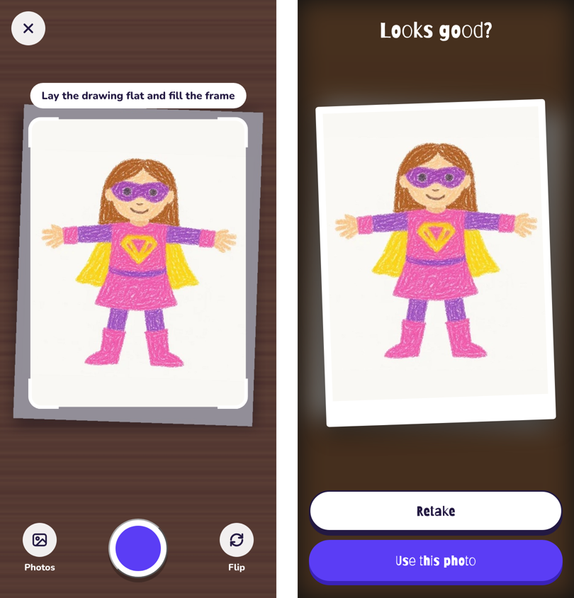
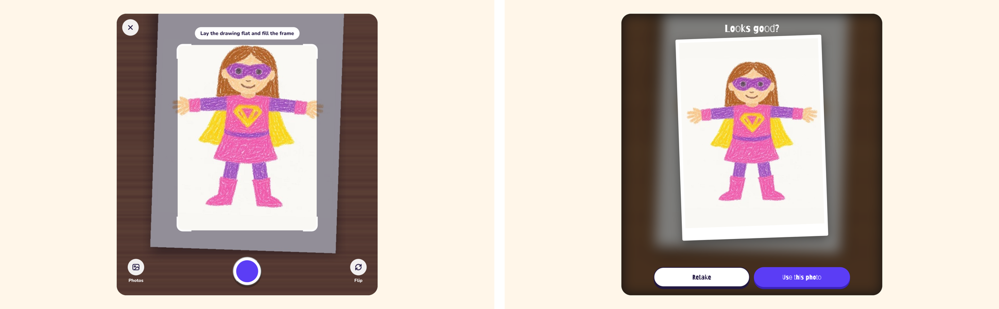

# Camera: photograph the drawing (S3), Maya, 2026-11-23

One screen serves both "Make a hero" and the class's "Take a photo".

**Capture**
- The live feed is full-bleed, from the **rear** lens. The rear lens is never
  mirrored.
- The frame guide is a 3:4 portrait rectangle with four white corner marks.
  Outside it, a dark scrim; inside, clear. Above it, one white pill: "Lay the
  drawing flat and fill the frame."
- The close (×) is a 48 px white circle, top-left.
- The bottom row is on one axis:
  - "Choose a photo" (gallery icon) at the left
  - the **shutter** in the middle: 84 px, white ring, grape centre
  - **Flip** (camera icon) at the right
- No other chrome: no title, no bar.

**Review**
- What was inside the frame, cropped, shown as the app's polaroid (white,
  slight tilt) over the blurred feed.
- The title "Looks good?" in the display face, white.
- Retake (secondary), then **Use this photo** (primary, last). On a phone
  they are stacked; on a desktop they sit in one centred row.

**Desktop:** the same screen as a centred card, 760 px wide, over the dimmed
app. Flip is shown only when there are two cameras.

**Build notes (Liran):**
- react-webcam with `facingMode: {ideal: 'environment'}`.
- `mirrored` only for the front lens.
- Crop to the guide's rectangle on capture.
- "Choose a photo" opens the existing file input.

### Revised after Dana's gate review (2026-11-24)

- **Review is one frame.** The capture crop snaps to the paper, not to the
  guide box, so the polaroid hugs the drawing with no table margin inside it.
  (Build: crop to the guide, then trim the outer band if it is not paper.)
- **Labels.** The side buttons are labelled "Photos" and "Flip". Flip uses
  the rotate-arrows icon, so it never reads as a second shutter.
- **Hint pill:** exactly 16 px above the guide (measured: 16.0).
- **Guide:** centred, with 43 px left and right at 390 px.
