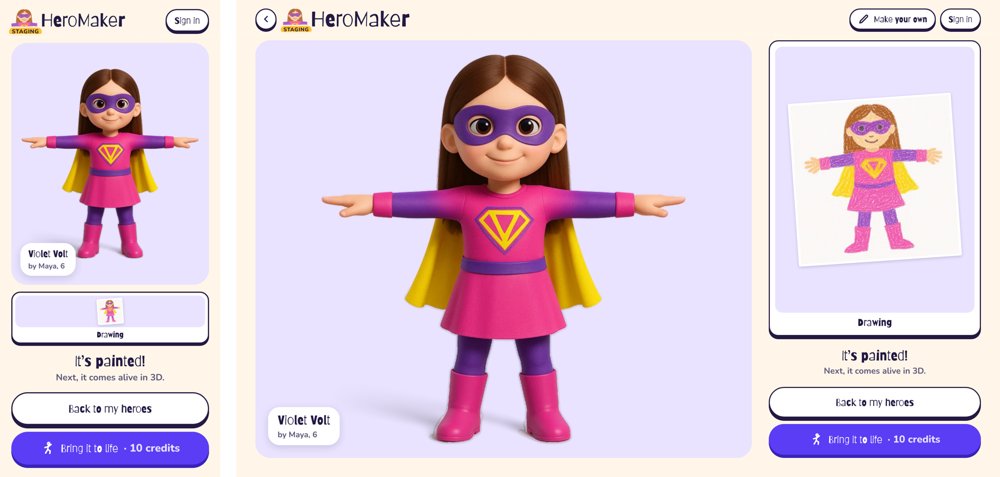

# Paywall pause: "It's painted!" (design for PR #350, Maya, 2026-11-23)

The hero paused for credits after the painting. The behaviour is unchanged
(`not_enough_credits`, `data-paywall`, Buy credits).

**Stage**
- The painting, big, on the stage sun. It is the chosen chapter.
- No "Bring it to life" pill on the stage: the primary button says it, and
  two of them is a duplicate. This also takes away the pill that sat on the
  figure's belly.
- The name card stays as it is: "Violet Volt · by Maya, 6".
- No moves (there is no 3D yet). The drawing tile is the only other chapter.

**Copy** (two sentences, each on its own line)
- Heading, Toy Box display face (`tb-h2`): **It's painted!**
- Line, body face, ink-2: **Next, it comes alive in 3D.**
- The hero's name is not in the heading, because the name card already says it.

**Buttons**, stacked, primary last
- Secondary: **Back to my heroes**
- Primary: **Bring it to life · 10 credits**. The icon is the dance figure.
  The price follows the words (rule 27). It opens Buy credits, as #350 does.
  N comes from the step's cost.

**Never** on this screen: red, a cross, "failed", or a greyed hero.
