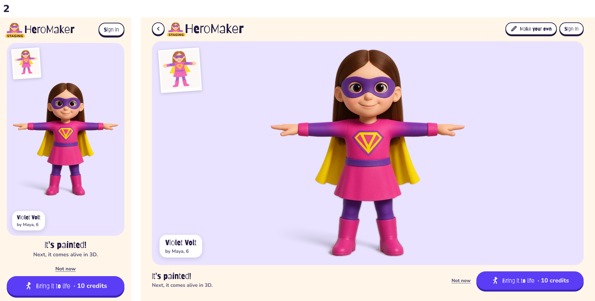
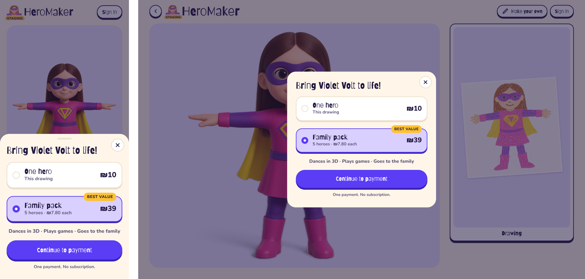

# Paywall pause: "It's painted!" (design for PR #350, Maya, 2026-11-23)

The hero paused for credits after the painting. The behaviour is unchanged
(`not_enough_credits`, `data-paywall`, Buy credits).

**Stage**
- The painting, big, on the stage sun. It is the chosen chapter.
- No "Bring it to life" pill on the stage: the primary button says it, and
  two of them is a duplicate. This also takes away the pill that sat on the
  figure's belly.
- The name card stays as it is: "Violet Volt · by Maya, 6".
- No moves (there is no 3D yet). The drawing tile is the only other chapter.

**Copy** (two sentences, each on its own line)
- Heading, Toy Box display face (`tb-h2`): **It's painted!**
- Line, body face, ink-2: **Next, it comes alive in 3D.**
- The hero's name is not in the heading, because the name card already says it.

**Buttons**, stacked, primary last
- Secondary: **Back to my heroes**
- Primary: **Bring it to life · 10 credits**. The icon is the dance figure.
  The price follows the words (rule 27). It opens Buy credits, as #350 does.
  N comes from the step's cost.

**Never** on this screen: red, a cross, "failed", or a greyed hero.

## Round 2 (Raz rejected round 1, especially on the phone): three options

All three share one focus: the painting fills the stage, and one ask sits
under it:
- the heading "It's painted!" (display face)
- the line "Next, it comes alive in 3D."
- a quiet "Not now" text link
- the primary "Bring it to life · 10 credits", last

There is no Drawing card, no chapter tiles, no moves and no second button.
Desktop is the same layout: the stage on top, and one row under it with the
copy on the left and the ask on the right.

1. **Focus.** Only the painting and the ask. Nothing else competes.
   
2. **The drawing as a corner polaroid** on the stage (top-left, tilted). The
   wow is "this drawing became this", and the corner costs no height.
   **Maya's pick.**
   
3. **A step bar over the copy:** ✓ Drawing · ✓ Painting · ● 3D hero. It says
   "you are here, one step left".
   

## Round 3: a real paywall (Raz, 2026-11-23: "a clear pop-up that asks for money, explains the plans, and sends them to payment")

The rounds above were a nudge, not a paywall. This one follows the standard
mobile paywall layout (Simply Piano, Kahoot, the Adapty and RevenueCat
studies): headline, then three benefits, then plan cards with one
recommended, then one CTA, then the fine print.

**When it opens**
- Automatically, as soon as the painting is ready and the account cannot pay
  for the 3D steps.
- Again from "Bring it to life" if it was closed.
- **Phone:** a bottom sheet over the dimmed hero page.
- **Desktop:** a 480 px centred dialog.

**What it shows**
- **Header:** the hero's own painting (thumb), then the heading "Bring
  <name> to life!" in the display face.
- **Benefits:** three ticks.
  - "She dances, waves and flips in 3D"
  - "Play games with her"
  - "Send her to the whole family"
  - Pronouns come from the hero, or are neutral: "It".
- **Plans:** from `GET /api/v1/packs`.
  - One hero: ₪10, "This drawing".
  - Family pack: ₪39, "5 heroes · ₪7.80 each", badge **Best value**,
    pre-selected.
  - Radio cards: the selected one is grape, with grape depth.
- **CTA:** "Continue to payment". It calls `POST /api/v1/checkout` with the
  selected slug and goes to `checkout_url`.
- **Fine print:** "One payment. No subscription."
- **Close:** × top-right; the grip on the phone.

**After payment** the buyer returns to the hero being made, with the 3D steps
running. Credits come from the webhook only, as now.

No red, no "failed", no "credits" word.

### Round 3, revised after Dana's gate review (2026-11-24)

- No hero thumbnail in the sheet. The painting behind is the picture, so the
  thumbnail duplicated it and nested a frame in a frame.
- Behind the sheet: the PAINTING (this is the moment it exists). There is no
  3D hero tile, because it does not exist yet. The name card, Share and Play
  are hidden while the sheet is open.
- The name appears once, in the heading.
- The desktop dialog is 480 px, centred on the screen (measured).
- This is still a mock-up on staging, not a built screen. Raz sees it as a
  labelled proposal. Dana measures the real build on staging.

### Round 3, after Raz's notes (2026-11-24)

- 24 px between the plan cards, so the Best value badge has room above the
  Family card.
- The three ticks are gone. Under the plans there is one line, "Dances in 3D
  · Plays games · Goes to the family", in body ink-2, kept on one line.
