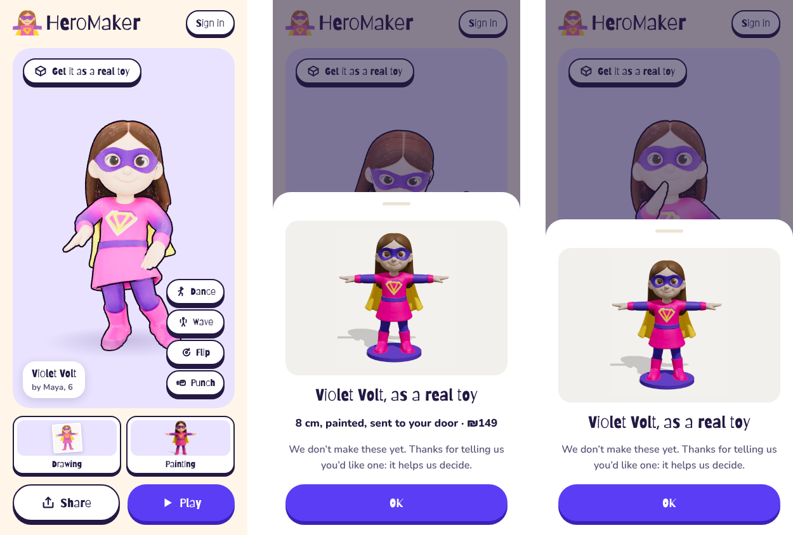
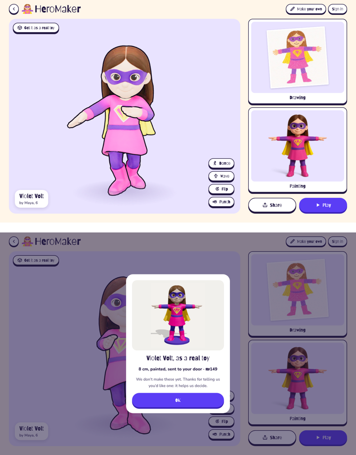

# "Get it as a real toy": fake door (design for Raz, 2026-11-23)

Asked for by Nir · 3D (Phase 1, step 3; H-034/H-036).

- **Where:** a pill at the top-left of the hero card, "Get it as a real toy".
  That corner is free: the name card sits at the bottom-left, the moves at
  the bottom-right, the ⋯ at the top-right. It shows on every chapter, since
  wanting a toy has nothing to do with which picture is in view.
- **Tap:** a sheet on a phone, a dialog on a desktop. It has the toy picture,
  "<Hero>, as a real toy", and with the price version "8 cm, painted, sent to
  your door · ₪149". Then the honest line: "We don't make these yet. Thanks
  for telling us you'd like one: it helps us decide." One button, OK. It
  collects nothing.
- **Analytics:** toy_interest_tapped {hero_id}, one per tap.
- **Picture:** the print preview where one exists (Violet,
  docs/toy/violet_toy_preview.png). For every other hero, its painting on the
  same grey plate, until print previews exist.

