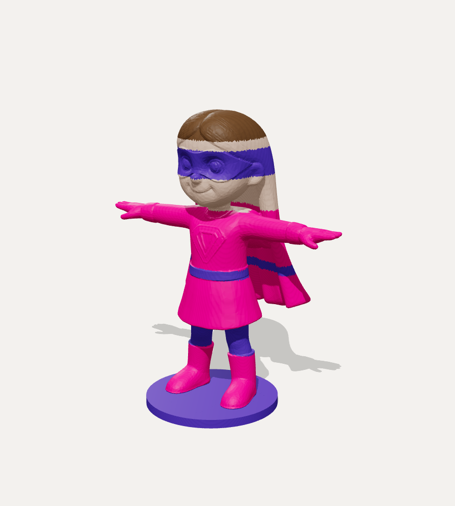

# What a printed toy costs, and the cheap way to print it

Raz, 2026-11-23: a toy must cost at most ₪80-120 to print; nobody pays more than
₪150. Slicer estimates for Violet (PrusaSlicer 2.7.2, Bambu P1S/X1C + AMS profile,
0.2 mm layers unless noted). Nothing has been printed yet.

## Assumptions

- Our own Bambu P1S + AMS (or a maker paid per piece): about ₪3 per machine hour
  (printer ~₪4,000 over ~2,000 working hours, power, nozzles, failed prints).
- PLA ₪80/kg. Hand work ₪60/h. Add ~15% for failed prints.
- A shop that charges by the hour (JLM SPARK: ₪120/h) is never cheap enough.

## Results

| Version | Time | Filament (of it waste) | Swaps | Cost on our printer |
|---|---|---|---|---|
| **8 cm, colour by height bands + paint-pen face** | 3.9 h | 57 g (26 g) | 64 | **≈ ₪35** |
| **10 cm, colour by height bands + paint-pen face** | ≈ 4.6 h | 78 g (30 g) | 67 | **≈ ₪40** |
| 8 cm, one colour + hand painting | 2.2 h | 31 g | 0 | ≈ ₪50 (40 min painting) |
| 8 cm, every triangle painted (AMS) | 16.4 h | 176 g (140 g) | 621 | ≈ ₪75, one toy per printer per day |
| 10 cm, every triangle painted (AMS) | ≈ 25 h | 272 g (214 g) | 959 | ≈ ₪110, one toy per printer per day |
| 12 cm ball-joint action figure (Hi3D split), one colour, 0.12 mm | 9.6 h | 66 g | 0 | ≈ ₪40 + assembly |

## The method: colour by height bands

Toy figures mostly change colour from bottom to top: boots, legs, skirt, belt,
shirt, face, hair. `toyprep.py --bands=3` gives each height band one colour (voted
by what a person sees from the front, at the body's middle), so the printer swaps
filament a few times per toy instead of 1-2 times per layer.

- Good: base, boots, legs, skirt, belt, shirt, arms come out right.
- Lost: anything that changes colour sideways at the same height: the mask, the eyes,
  hair beside the face, the cape, the chest emblem. Those are finished with paint pens
  (2-5 minutes), or the head is printed apart.

## Other cheap routes

- **Ball-joint figure, one colour per part, printed part by part** ("by object"
  in Bambu Studio): swaps only between parts (~6). Each part takes its main colour.
- **Full-colour printer** (HP Jet Fusion 580, Impact Labs, Tel Aviv): prints the
  texture itself, no hand work. Priced by volume: needs a quote. Violet is ~26 cm³
  solid at 8 cm.
