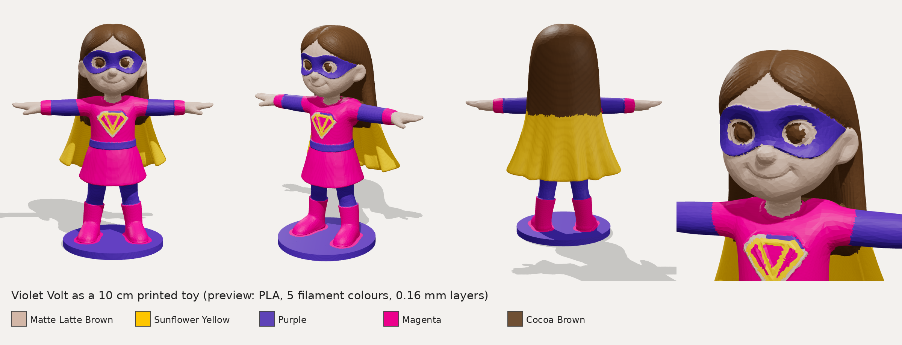

# Violet as a real toy: the first print file (Phase 1, step 2)

Owner: Nir (3D). Started 2026-11-23. For the Schneider table (10 Dec) and ad photos.
Hero: Violet Volt, staging gallery (public), `model.glb` from the meshy_3d step.



## The file

`violet_toy_5colour.3mf`: one watertight object, every triangle painted with one of
5 filaments. Opens painted in Bambu Studio, OrcaSlicer (`paint_color`) and PrusaSlicer
(`slic3rpe:mmu_segmentation`). Made by `scripts/toy/toyprep.py`; sliced with
PrusaSlicer 2.7.2 CLI and `scripts/toy/bambu_like.ini` (a Bambu P1S/X1C + AMS
approximation: single nozzle, filament swaps, prime tower).

| | |
|---|---|
| Size | 93 x 53 x 102 mm (100 mm figure on a 46 mm, 3 mm round base) |
| Printable | watertight (MeshFix + manifold union with the base); walls under 0.8 mm: 0.03% of the surface |
| Supports | needed (T-pose arms, cape, skirt hem, chin): organic/tree, auto at 45° |
| Colours | Bambu PLA: Matte Latte Brown (skin), Sunflower Yellow, Purple, Magenta, Cocoa Brown (hair, eyes) |
| Colour fidelity | mean ΔE 17 vs the hero's texture; 39 colour regions after speckle clean-up |

## What it costs to print (slicer estimates, not a real print yet)

| Variant | Filament | Of which purge waste | Colour swaps | Print time |
|---|---|---|---|---|
| **5 colours, one print (AMS)** | **272 g** | 214 g (79%) | **959** | **~25 h** |
| 1 colour (hand-paint or plain) | 46 g | 0 | 0 | 3 h 41 min |

Time for 5 colours: PrusaSlicer 2.7 overflows its estimate above ~24 h; the same
file at 0.16 mm read 25 h 47 min before a small fix, and 3.7 h + 959 swaps x ~80 s
gives ~25 h. Filament at ₪80/kg: ~₪22 (5 colours) or ~₪4 (1 colour).

**The finding:** a figure has 4-5 colours on almost every layer, so a single-nozzle
AMS printer swaps filament ~1.5 times per layer. That is 21 of the 25 hours and 4 of
every 5 grams. At a shop that charges by the hour (JLM SPARK: ₪170 first hour,
+₪120/h) one 5-colour Violet would cost over ₪3,000. Multi-colour FDM of a whole
figure does not fit a $25 toy (H-036) unless the swaps go away.

## Ways to make it cheap (to decide, not built)

1. **Full-colour print** (HP Jet Fusion 580, Impact Labs, Tel Aviv): prints the
   texture itself, no palette, no swaps. Quote needed. Likely best look for the sample.
2. **Print in parts, one colour each** (hair+head, body, cape, arms, legs, base), pins
   and glue: ~4-5 h, ~50 g, 0 swaps. Matches Phase 2 (joints), and Hi3D/Meshy splits exist.
3. **One colour + hand painting**: 3.7 h, 46 g, plus painting labour.
4. **Fewer colours per layer**: 4 colours, 0.2 mm layers, flush into infill. Helps by
   ~20%; does not fix it (785 swaps, 173 g purge at 0.2 mm).

## Reproduce

```bash
.venv/bin/pip install trimesh pymeshfix manifold3d scikit-image scipy rtree pillow
.venv/bin/python scripts/toy/toyprep.py model.glb out --colours=5 --base-colour=Purple --edge=0.8
prusa-slicer --export-gcode --load scripts/toy/bambu_like.ini --center 110,110 -o violet.gcode out/toy.3mf
.venv/bin/python scripts/toy/toglb.py out/toy_coloured.ply render/toy.glb   # then shoot.js for the preview
```
