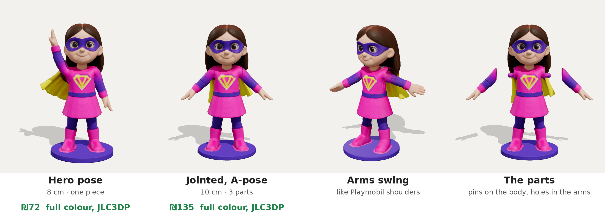

# Test order for Schneider (10 Dec): two Violets in full colour

| File | What | Size | Volume | Price (JLC3DP Full Color Resin) |
|---|---|---|---|---|
| `violet_hero_8cm_fullcolour_ply.zip` | Hero pose, one piece, on a base | 48 x 43 x 82 mm | 25.7 cm³ | ≈ $19.4 / ₪72 |
| `violet_jointed_10cm_fullcolour_ply.zip` | A-pose, 3 parts: body + 2 arms; the arms swing on pins (Playmobil-style) | 93 x 53 x 102 mm | 48.2 cm³ | ≈ $36.4 / ₪135 |

Prices: volume x 1.3 g/cm³ x $0.58/g, from JLC's quote page, before shipping. The two
together are about $56, under Israel's $75 import-VAT threshold.

Every file is a PLY with vertex colours, watertight, in millimetres. JLC3DP takes PLY
for full colour ("vertex colouring: more faces, clearer colour").

## The jointed one

- Pin: 3.4 mm diameter, 4 mm long, with a small snap bulge at its end. It sits on the
  body and its axis runs left-right through the shoulder.
- **The left arm's hole is tight (0.15 mm clearance) and the right arm's is loose
  (0.25 mm).** One print tells us which to use from now on.
- Made by `scripts/toy/joints.py` from the A-posed hero (`pose.html` + `bake.js` pose
  the rigged model; `toyprep.py` makes it printable).

## How to order (Raz or Gidi: needs a JLC account and payment)

1. Go to https://jlc3dp.com/3d-printing-quote, unzip the files and upload the 4 PLY files.
   Choose **Full Color Resin** and keep the units in mm.
2. Shipping: choose **DHL**. Build takes about 4 days and DHL about 3-5 days, plus 1-3
   days for Israeli customs. Ordered on 24-25 Nov, it should arrive around 3-8 Dec. That
   is tight. Have the recipient's ID number ready, because JLC asks for it for Israeli customs.
3. Write down the shipping cost and the date it arrives. That is half of what this test
   order is meant to find out.

## Backup in Israel (if JLC cannot promise 8 Dec)

Nobody has been contacted. Raz sends the messages or approves sending them.

- **AMP3D, Jerusalem** (Harechavim 13), 02-5805800, WhatsApp 052-6284488,
  moshe@amp3d.co.il. They have written about a ProJet 460, which prints full colour in
  gypsum. Ask whether they offer it as a service.
- **Synergy RM, Netanya**, 072-222-4045. They list a Stratasys J750 (PolyJet, full colour).
- **INDUS3D**, 050-9913335. They list PolyJet and take STL/OBJ/3MF files.
- If none of them can, a Jerusalem maker (3D-Chen, 054-780-6752) prints the
  height-band PLA version so that at least one toy is there on 10 Dec.

Draft message (Hebrew):

> שלום, אני רז מ-HeroMaker. יש לנו שני קבצי תלת מימד בצבע מלא (PLY עם צבע לקודקודים, או OBJ עם טקסטורה):
> דמות של 8 ס"מ (26 סמ"ק) ודמות של 10 ס"מ בשלושה חלקים (48 סמ"ק). אפשר להדפיס אותן בצבע מלא
> ולקבל אותן בירושלים עד 7 בדצמבר? כמה זה יעלה? תודה!
